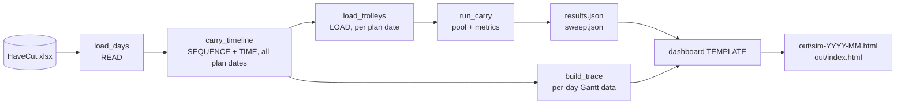

# SIM_SPEC.md — everything that directly changes the simulation's output

**Purpose.** This is the rebuild specification for the CCT Trolley Model. It lists
every input, constant, algorithm step, tie-break, quirk and validation number that
moves a result. `RULES.md` explains *why* each rule exists; this file states *exactly
what is computed*. Extracted from `assumptions.py`, `model.py`, `scenarios.py`,
`tools/model.js`, `tools/assumptions.js`, `dashboard.py` and a direct profile of the
source workbook on **2026-11-05**.

**Precedence.** If this file disagrees with the code, the code is right. When
rebuilding, every behaviour marked **QUIRK** must either be reproduced (to match the
published numbers) or changed deliberately and reported with a before/after table.

**Status, 2026-11-09.** The published model is the **carry-over floor** (§18) and nothing else:
no cold start (the closed-day model, `run()` / `runDay()` / `runTimeline()`, was removed on
2026-11-09, user: "there will never be a cold start"), no machine speed factor (removed the same
day: the model runs at the G2 standard pace), cutter changeover 5 min and moving 1.5 min (both
ESTIMATES, cutters only) in the floor (Q19), and S1–S3 pair first and assign each pair over the
whole floor (§5). The headline is in §14; how it moved from the 2026-11-06 build is in §18
(`npm run beforeafter`). Cold-start text kept for history is marked **HISTORICAL (cold-start
model, retired 2026-11-09; no longer reproducible)**. Scope of every number: April–June 2026, 79
plan dates, 6,501 tables, unless a line says otherwise.

**Update, 2026-11-10.** S0 is now the **real Job Sequence** (`data/SQL Job Sequence Logic.sql`,
`P_Task_Calculate`, core loop only), mirrored by `sequenceJobSeq` (§5). The model's S0 until
2026-11-09 clustered a whole MO + colour + batch onto one cut group (user, 2026-11-09: that is not
how the floor works) and survives only as the internal mode `today_grouped`, used by
`npm run beforeafter`. **Every S0 number moved; S1–S3, the hold variants and the other 78 sweep keys
did not move by one bit.** S0 → S1 is now "new dispatcher + pairing" (two changes), not pairing
alone. The night shift starts at 18:00 (§4; no published number moves). Tables below that quote S0
figures from the pre-2026-11-10 S0 are marked as such; the current figures are §14 and §18 stage (iv).

**Update, 2026-11-10 (later): the floor is live.** `tools/floor.js` (shared by `model.js` and the Lab,
inlined into the page) replaces the old once-a-day plan for the published model (§6b). Every
published number moved, S0–S3 and all 117 sweep keys; §14 and §18 stage (v) have them, and §6–§9,
§12, §17 text that describes "plan once at 07:15, every table ready, the cutter cutting in spread
order" now describes the floor of 2026-11-09 (`A.LIVE_FLOOR = false`, kept for `npm run beforeafter`).
The Lab's Dynamic spreader pick and Keep same colour close were removed (user). **No Python mirror of
the live floor exists yet** (Python is not installed).

Contents

1. Input data
2. Row filters and the task record
3. Constants
4. Machines, layout and shifts
5. Stage 2 — sequencing
6. Stage 3 — timeline (spreading, cutting, blocking)
7. Stage 4 — loading (compartments, trolleys, combine, WIP hold)
8. Metrics and aggregation
9. Scenarios and the sweep
10. Task readiness status (display only)
11. Quirks that change numbers
12. Measurement-only extensions and their results
13. Not modelled, estimated, or missing
14. Validation targets for a rebuild
15. Decisions to make before rebuilding
16. Codebase map
17. Rules Lab
18. The carry-over floor (the published model since 2026-11-06)

---

## 1. Input data

| Item | Value |
|---|---|
| File | `data/PPC Planning - Old Data.xlsx` |
| Sheet | `HaveCut` (68 columns) |
| Span | 199 plan dates, 2026-01-02 → 2026-08-26 (200 distinct Plan Date values on B rows) |
| Rows | 22,638 with a non-empty column A (`MO`) |
| Published scope | `WEBSITE_MONTHS = 2026-04, 05, 06` → 79 plan dates, 6,501 tables, 82.3 tables/day |
| Regression fixture only | `data/planppc.xlsx` (20 dates, 1,863 tables; `PIN_DATA_FILE`) — read only by `npm run regress`, never by a real build |

**Row types in the file**

| Type | Rows | Treated as |
|---|---|---|
| B | 15,928 | the modelled tables |
| C | 6,117 | setup added to its B table (rule G3). `Act LayerQty = 1`, `Marker Length = 1` placeholders |
| C1 | 77 | **ignored** — placeholders like C, but the code only matches `Type == 'C'` (QUIRK Q15) |
| C2 | 73 | **ignored** — same as C1 |
| T1 / T / P / R / L | 226 / 87 / 103 / 5 / 1 = 422 | excluded by J2 on purpose; real layers and lengths, so real machine time is missing |
| W | 21 | excluded; real layer counts, `Marker Length = 1` |

**Columns the model reads**

| Column | Used for |
|---|---|
| `MO` (col A) | row-exists test; combine and recall key |
| `Type` | B = task, C = setup source |
| `First Table` | `Y` excluded (5 B rows) |
| `Table No` | joins C rows to their B table; C-setup hash seed |
| `Color` | combine and recall key |
| `Batch No` | same-batch rule, batch cap, stretch status |
| `Lot` | `has_fabric` status test only |
| `Plan Date` | groups tables into days (Excel serial, date part) |
| `Marker Ratio` | pieces per size: `"XS/1,S/1,M/4,L/3,XL/2"` |
| `Act LayerQty` | pieces, spread time, cut time |
| `Marker Length` | spread time, cut time, table occupancy (treated as **yards**) |
| `Marker Date` | `has_pattern` status test only |
| `Pull Date` | actual finished-spreading timestamp: stretch status, slip statistic |
| `STYLE` | carried on the task, not used in any decision |

**Columns available but NOT used — profiled 2026-11-05 on B rows**

| Column | Filled | What it holds | Possible use in a rebuild |
|---|---|---|---|
| `Spd_Remark` | 100% | `"<colour code> <component> Graphic <letter>, <order type>"`, e.g. `00W Body Graphic A, QR` | **Component is here.** "Body" on 15,799 of 15,928 B rows (plus "OFF Body" and unparsed "Body" variants). Rule L6 is now checkable: component is effectively single. |
| `Flower` | 94% | print or graphic letter (A–Q) | matches the `Graphic` letter in `Spd_Remark` on 13,024 of 14,872 rows. A print variant: may matter for combine and cutter setup. |
| `Spd_Remark5` | 69% | spreading instruction (Vietnamese) | **Stretch spreading is explicit here:** "trải hết vải" (spread all fabric) on 2,103 rows, "trải hết batch" (spread whole batch) on 1,357, "trải đúng lớp" (exact layers) on 4,464, other 3,123, empty 4,881. The model instead *infers* stretch as the last table of a batch by Pull Date (44%). |
| `Marker Width` | 100% | fabric / marker width, 147 distinct values (e.g. 66.1) | cutter setup driver; spreading-table width check |
| `Cut Qty` | 100% | pieces cut (e.g. 770 = ratio sum 11 × 70 layers) | cross-check for `pieces = ratio × layers` |
| `Cut_Damage` | 100% | damage figure (e.g. −0.73) | yield / recut modelling |
| `Cut Date` | **2.4%** (378 B rows) | actual cut timestamp | real Pull → Cut gap: p10 27 min, **p50 82 min**, p90 313 min, never negative. A calibration sample for cutting queues. |
| `Cut EmpNo1` | 2.4% | cutting operator | — |
| `Import Date` | 100% | plan upload time | the "pattern within 1.5 h of upload" rule |
| `Sample Time`, `OK Time` | 99.7% | marker sample / approval times | pattern readiness |
| `Print Date` | 100% | marker print time | pattern readiness |
| `Paper Sample` | 100% | marker paper code (89 values) | — |
| `Marker Name` | 100% | marker id incl. style and size range | — |
| `订单类型` (order type) | 99.8% | QR 15,549 / Normal 337 / SQR 7 / empty 35 | priority rules |
| `User ID` | 100% | planner (8 users) | — |
| `Bar_Code` | 100% | table barcode | unique id |
| Size columns `4-5`…`160`, `XXS`…`4XL` | 100% | per-size ratio broken out | cross-check `Marker Ratio`; kids and number sizes (J3) |
| `Lot` | 100% | **always `1`** | carries no information |
| `Marker Bin Barcode`, `Monitor`, `Marker IN Store Date`, `Cut EmpNo2-4` | 0% | empty | — |

**Not in the data at all:** real Net_Rate; the spreading or cutting machine each table
actually ran on; fabric arrival or relax-start time; shrinkage and shade lot; trolley
dispatch and return times; compartment counts at dispatch.

## 2. Row filters and the task record

Applied in this order. Counts are for the full file.

1. Keep rows whose column A (`MO`) is truthy → 22,638.
2. Count C rows per `(plan date, Table No)` → `c_tables`. Only `Type == 'C'`, not C1 or C2.
3. Keep `Type == 'B'` and `First Table != 'Y'` → 15,923. Everything else is "skipped" (J2).
4. Drop rows where `Plan Date` is not a date.
5. Parse `Marker Ratio`: split on `,`; within each part split at the **last** `/`; trim; skip an empty count; count = integer part of the number.
6. Drop rows with an empty ratio, `Act LayerQty <= 0` or `Marker Length <= 0` → **15,920 tasks**.

**Task record**

| Field | Formula |
|---|---|
| `plan_date` | `YYYY-MM-DD` from the Excel serial. Read raw serials; `date = (serial − 25569) days` from the Unix epoch, in UTC (QUIRK Q12). |
| `universal` (`needs_trolleys`) | every size in the ratio is in the H5 film map (XXS, XS, S, M, L, XL, XXL, 3XL, 4XL). Note `2XL` is **not** in the map (J3). |
| `pieces_by_size` | `ratio[size] × layers` for universal tables; empty otherwise. **Insertion order is kept** — it decides which film opens a trolley first. |
| `setup` | if the B table has ≥1 C row: `c_setup_minutes(day, table_no)`. Multiplied by the C-row count only if `C_SETUP_PER_C_ROW` (False). Else 0. |
| `spread_minutes` | `layers × (0.80 / 8.5) × marker_length + setup` |
| `cut_minutes` | `layers × (0.40 / 8.5) × marker_length` (no setup) |
| `marker_length` | `Marker Length` as a float, in yards |
| `has_pattern` | `Marker Date` is a date |
| `has_fabric` | `Lot` and `Batch No` both non-empty |
| `spread_done_at` | `Pull Date` as a datetime |
| `order_type` | `订单类型` (QR / Normal / SQR) trimmed, `''` if empty; the last field of the task. Read only by S0's priority (§5). In the April–June data: 6,499 QR, 2 Normal. |
| `is_batch_last` | this task is the batch's table with the latest `Pull Date` **across the whole file**, not per day (QUIRK Q11) |
| `batch_first_planned` | earliest plan date of the batch, file-wide |

**C-setup hash (G3 / I3 / N):**

```
key     = "YYYY-MM-DD|" + table_key(Table No)     # integer number -> "6106"; string -> trimmed
h       = FNV-1a 32-bit over the UTF-8 bytes of key
          (offset 2166136261, prime 16777619, multiply mod 2^32 — Math.imul in JS)
tenths  = 80 + (h mod 21)                          # 80..100
minutes = tenths / 10                              # 8.0..10.0, mean 9.01
```

A non-integer numeric `Table No` must raise an error, because Python and JS spell
decimals differently. Result: 6,269 of 15,920 tasks (39.4%) carry a setup.

## 3. Constants

Every one lives in `assumptions.py` (mirrored in `tools/assumptions.js`).

| Name | Value | Status | Rule |
|---|---|---|---|
| `TROLLEY_COMPARTMENTS` | 5 | rule | H3 |
| `COMPARTMENT_CAP` | 150 garments | rule | H1 |
| `MAX_BATCHES_PER_TROLLEY` | 2 (never 3) | proposed rule | Change 2 |
| `MAX_TROLLEYS_PER_COMBINE` | 4 | rule | H8 |
| `TROLLEY_BAYS` | 52 (13 WS × 4) | rule | H7 |
| `FLEET_SIZE` | 1,200 | fact | — |
| `CYCLE_DAYS_ALLOWED` | 5 (1 + 3 + 1) | allowance | — |
| `CYCLE_DAYS_ESTIMATED` | 7 | **ESTIMATE, never timed** | — |
| `WIP_HOLD_MINUTES` | 60 | proposed | Change 3 |
| `WIP_HOLD_ANY_WORKSTATION` | True | proposed (open question) | Change 3 |
| `WIP_HOLD_MATCH_ON` | (mo, color, film_size) | proposed | Change 3 |
| `FILM_SIZE_BY_GARMENT_SIZE` | XXS/XS/S → 90; M/L → 100; XL/XXL/3XL/4XL → 110 | substitute for Net_Rate | H5 |
| `RELAX_HOURS` | 24 | precondition, not simulated | — |
| `CUT_GROUPS_BY_CUTTER_COUNT` | 5/6/7/8 cutters (section 4) | 5 = floor | F2 |
| `CUTTER_COUNT` | 5 | floor | F2 |
| `FLEXIBLE_CUT` | 24-03 → [24MC1, 24MC2]; 24-05 → [24MC2, 24MC3] | rule | F8 |
| `NIGHT_SHIFT_SPREADERS` / `_CUTTERS` | 24-01/02/03 / 24MC1 | rule | F5–F7 |
| `SHIFT_START_MINUTE` | 435 (07:15 = t 0) | measured | — |
| `DAY_SHIFT` | (0, 765) = 07:15–20:00 | measured | — |
| `NIGHT_SHIFT` | (645, 1305) = 18:00–05:00 | measured (user, 2026-11-09; was 630 = 17:45) | — |
| `DAY_BREAKS` | (270, 330), (600, 630) = 11:45–12:45, 17:15–17:45 | measured | — |
| `NIGHT_BREAKS` | (885, 915), (1125, 1155) = 22:00–22:30, 02:00–02:30 | measured | — |
| `BREAKS_STOP_MACHINES` | True | **unconfirmed** | — |
| `SPREADING_TABLE_LENGTH_M` | 21.2 m → 23.18 yd (× 1.0936133) | **measured**, one value for all 13 | G6 |
| `LAY_NEEDS_FULL_LENGTH` | True (declared; the code always needs full length) | conservative | G6 |
| `MACHINE_FILL_TARGET` | 0.70 | heuristic (used by `pick_machine`, i.e. S1–S3 and `today_grouped`; the real Job Sequence has none) | — |
| `ORDER_TYPE_PRIORITY` (`ORDER_TYPE_PRIORITY_DEFAULT`) | SQR 0, QR 1, Normal 2 (default 2) | **ESTIMATE**: the SQL's commented-out older rule (L1016-1076); the live `Job_Seq_Schedule_Priority` table was not supplied | S0 priority |
| `SPREAD_MIN_PER_LAYER_PER_YARD` | 0.80 / 8.5 = 0.09412 | rule | G2 |
| `CUT_MIN_PER_LAYER_PER_YARD` | 0.40 / 8.5 = 0.04706 | rule | G2 |
| `C_SETUP_MINUTES_MIN/MAX_TENTHS` | 80 / 100 | **ESTIMATE** | G3/I3/N |
| `C_SETUP_HASH_OFFSET/PRIME` | 2166136261 / 16777619 | algorithm | — |
| `C_SETUP_PER_C_ROW` | False | decision | — |
| `CUT_SETUP_MO_COLOR_MINUTES` | 5 | **ESTIMATE**, cutters only | user rule 2026-11-09 (Q19) |
| `CUT_TRAVEL_MINUTES` | 1.5 | **ESTIMATE**, cutters only | user rule 2026-11-09 (Q19) |
| `PULL_AHEAD_DAYS` | 1 | Rules Lab add-on value only (not in the published model) | user rule 2026-11-05 |
| `WEBSITE_MONTHS` | 2026-04, 05, 06 | scope decision | — |

There is **no machine speed constant**: the 2026-11-06 `SPEED_FACTOR = 0.80` (an ESTIMATE) was
removed on 2026-11-09, and spreading and cutting minutes are the G2 rates above.

## 4. Machines, layout and shifts

**Cut groups (F2) at each cutter count.** `24MC1` keeps 24-01/02/03 at every count.

| Cutters | Groups |
|---|---|
| **5 (floor)** | 24MC1: 01/02/03 · 24MC2: 04/05 · 24MC3: 06/07 · 24MC4: 08/09/10 · 24MC5: 11/12/13 |
| 6 | MC1: 01/02/03 · MC2: 04/05 · MC3: 06/07 · MC4: 08/09 · MC5: 10/11 · MC6: 12/13 |
| 7 | as 6 but MC6: 12 · MC7: 13 |
| 8 | MC1: 01/02/03 · MC2: 04/05 · MC3: 06/07 · MC4: 08/09 · MC5: 10 · MC6: 11 · MC7: 12 · MC8: 13 |

The spreader order everywhere is the insertion order of these groups (24-01 … 24-13).
It decides every tie (section 11).

**Working spans** (minutes from 07:15). The start is `min(shift start, 0)`, the end is the
shift's end, minus the breaks that fall inside.

| Machine | Spans | Staffed minutes |
|---|---|---|
| Day-only spreader or cutter | [0,270] [330,600] [630,765] | **675** |
| 24-01/02/03, 24MC1 | [0,270] [330,600] [630,885] [915,1125] [1155,1305] | **1,155** |

The night shift starts at 18:00 (`NIGHT_SHIFT = (645, 1305)`, user, 2026-11-09; it was 17:45
in the code before). In the published model the start has no effect: the night machine's window
simply runs on from 07:15 to 05:00 (`working_intervals` takes `min(NIGHT_SHIFT[0], 0)`). It only
sets the Lab's "Night only" option, where a night machine is staffed 600 min a day (615 at 17:45).

**`occupy(spans, start, minutes)`**: snap `start` forward to the next span, then consume
`minutes` span by span, jumping over gaps. If the spans run out, the remainder continues
on the raw clock (the cold-start model's unlimited overtime, retired quirk Q6; the carry-over timeline
appends enough synthetic staffed days that the spans never run out). Returns `[began, end]`.

## 5. Stage 2 — sequencing

Each plan date is sequenced on its own, on the morning it starts, around what the machines still
have committed (§18 step 4) — on the floor of 2026-11-09 (`A.LIVE_FLOOR = false`). On the live floor
(§6b) the same sequencers run unchanged at every 30-minute re-plan, one plan date at a time. `sequence(tasks, mode, layout, initLoad, initCut, moOneGroup)` routes:
`today` → `sequenceJobSeq` (S0, the real Job Sequence, from 2026-11-10); `today_grouped` →
`sequenceToday` (the model's S0 until 2026-11-09, `npm run beforeafter` only); `moOneGroup` on → `sequenceMoAware` (the old S1–S3 rule, the
**option "Keep an MO on one cut group"**, scenario field `mo_one_group`, default off); otherwise →
`sequencePairs` (S1–S3, published). The output is `plan[machine] = ordered list of tasks`.

**`pick_machine(candidates, load, work)`**:
1. Among `candidates`, those with `load + work <= staffed × 0.70` → the one with the least load.
2. Otherwise, any of the 13 spreaders with that room → the least loaded (QUIRK Q8: the table can leave its cut group).
3. Otherwise, the spreader with the lowest `load / staffed`.

Ties go to the first in spreader order.

**Mode `today` (S0, the real Job Sequence, `sequenceJobSeq`, user data `data/SQL Job Sequence Logic.sql`, `P_Task_Calculate`, core loop only; user answers 2026-11-09: pairing switch off, priority by the old commented rule, keep the 21.2 m table, core loop only, mirror the code as written):**

*Pass 1: every table gets a cutter (SQL L2105-2344).*
1. Tables in order of priority (`order_type`: SQR 0 < QR 1 < Normal = anything else 2, `ORDER_TYPE_PRIORITY`, an ESTIMATE), then plan order (row order of the date).
2. `spreadCount[c]` = Σ over spreaders of `1 / (cutters the spreader maps to)`, each spreader counted against its **fixed** cutter (`FLEXIBLE_CUT` gives 24-03 and 24-05 two cutters): 24MC1 2.5, 24MC2 1.5, 24MC3 2, 24MC4 3, 24MC5 3 (L1822-1834). `raw[c]` starts as the sum of `machineLoad` (the committed backlog, `initLoad`) of c's fixed spreaders, unweighted.
3. A table goes to a cutter that already holds a table of the **same MO + batch** this date, if there is one; otherwise to any cutter. Among those, the least `raw[c] / spreadCount[c]` (first cutter wins ties). Then `raw[c] += spread_minutes`.

*Pass 2: machine first (SQL L3693-, L4151-5258).* Until all tables are placed:
4. The spreader with the least `machineLoad` (**not divided by its shift minutes**; first in order wins ties) takes the next table.
5. Candidates: tables not yet placed whose cutter that spreader feeds (its primary, or the second cutter of 24-03 / 24-05). If there are none, all unplaced tables (SQL case 6).
6. It takes the one with the lowest `(priority, spread_minutes, plan order)`: **the shortest spreading time first**. The SQL's comment says "first table of the machine: shortest, then the one closest to the cutter's gap", but the code resets `@IsFirst` to 1 on every pass (L3715) and case 1 (L3889-3965) always finds a table first, so the gap term never runs (Q20). Mirrored as written.
7. `plan[m].push(table)`, `machineLoad[m] += spread_minutes`.

There is **no `pick_machine`**: no 0.70 fill target and no spill to other groups (the SQL has neither). No changeover or moving in the plan: the floor physics (`carryTimeline`: G6 21.2 m, changeover 5 / moving 1.5, `FLEXIBLE_CUT` earliest-free cutter, breaks, carry-over) run the plan unchanged. **Not modelled (no data in HaveCut, or out of scope): material and roll readiness, pull-later / merged-pull / merged-batch links, PadPrint / small-order / abnormal / first-bed machine flags, marker width, rush inserts, table locks, the same-MO same-batch switch (`SameBatchMoTogether`, off today), the 22-minute default cut, the SQL's cutter overwrite after the loop (L10363, L11639; probably a bug), and the SQL's 2-lay limit per spreading table (the measured 21.2 m is kept).**

**Mode `today_grouped` (the model's S0 until 2026-11-09, kept for `npm run beforeafter` only):**
1. Cluster by `(MO, colour, batch)`, keeping first-seen order.
2. Sort clusters by total `spread_minutes`, descending (stable).
3. For each cluster: cut group = `argmin(group_load / spreaders_in_group)`. Then sort its tasks by `spread_minutes` descending and place each one with `pick_machine(group's spreaders)`. Each placement updates the machine load and the group load.

This **scatters** a cluster across the group's machines.

**Modes `same_batch` (S1) and `cross_batch` (S2, S3)** — Change 1, rule (a), published since
2026-11-09 (`sequencePairs`; user: "Pair first, count tasks and takt time by pairs, then maximise
cutting-machine output; distribute back-to-back, not a whole MO to one cut group"):
1. Cluster by `(MO, colour)`, keeping first-seen order. Sort clusters by total spread, descending (this only sets the tie order of the units).
2. Within a cluster, sort by `(str(batch) ascending, spread_minutes descending)`.
3. Pass A, same batch: for each i, pair it with the first later j of the same batch where `can_combine(i, j, cross=True)` succeeds.
4. Pass B, different batch (`cross_batch` only): the same, for different-batch pairs. `same_batch` skips this pass entirely.
5. Unpaired tasks become single units. **All units of the whole day go into one list**, sorted by spread, descending (a pair counts as one unit, its work = both tables).
6. Each unit goes to the cut group with the smallest **busier side**: `max((group spread load + unit spread) / group spreader minutes, (group cut load + unit cut) / cutter minutes)`. The cut load starts from `initCut`, what each cutter still has to cut at the day's start in staffed minutes (the real cutter backlog, `carryTimeline`). Then `pick_machine(group, work = unit spread)` picks the spreader, and **both tasks of a pair are appended consecutively** (back-to-back on one spreader). Pairs of one MO + colour are therefore spread over the floor.
7. The loads are credited to the machine's **real** cut group (`primary_cut[machine]`), because `pick_machine` can leave the chosen group (Q8). The cut-side credit goes to the spreader's primary cutter although `FLEXIBLE_CUT` lets 24-03 and 24-05 use a second cutter: an **approximation kept on purpose** (the timeline still picks the freer cutter).

**The option "Keep an MO on one cut group"** (`sequenceMoAware`, the S1–S3 rule published on
2026-11-06; scenario field `mo_one_group`, Lab option `moOneGroup`) is steps 1–5 above, then the cut
group is chosen **once per cluster** = `argmin(group_load / n)` and every unit of the cluster is placed
with `pick_machine(group, …)` in that group. It is case 2 of `npm run beforeafter` (§18); S0 ignores it.

**`can_combine(a, b, cross)`** (used in sequencing and in loading):
- `null` if either table is non-universal;
- or MO differs, or colour differs;
- or batch differs and not `cross`;
- or `trolleys_for(combined_compartments(a, b)) > 4`.

Otherwise it returns the combined compartments. It does **not** check film, component
or workstation (QUIRK Q2).

## 6. Stage 3 — timeline (spreading, cutting, blocking)

One timeline runs over **every plan date** (§18 for how the dates chain; there is no closed day and
no empty start). State per spreader: `free` (when it is next free), `lays` (a list of
`[length, table_free_from, cut_end]`). State per cutter: `cutFree` and `lastCut` (MO, colour, spreader
of its last cut), both carried across plan dates.

For each table, taken from the spreader with the earliest next staffed instant (§18 step 5):
1. **G6 room:** `start = room_at(lays, 23.18 yd, eff, marker_length)`, `eff` = the spreader's next staffed instant. This is the earliest time `free_length >= marker_length`, found by scanning the lays' marks, then a 40-step bisection; it falls back to the latest `cut_end`.
   `free_length(t) = table − Σ used(lay)`, where `used` = the full length if `t <= table_free_from`, 0 if `t >= cut_end`, and `length × (cut_end − t) / (cut_end − table_free_from)` in between. **The cutter frees length linearly.** Lays that ended before `eff` are dropped from the list.
2. `blocked = staffedBetween(spreader spans, eff, start)`: staffed minutes only.
3. `[spread_start, spread_end] = occupy(spreader spans, start, spread_minutes)`; `free = spread_end`.
4. **Cutter:** `flex = FLEXIBLE_CUT[machine]` or `[primary cutter]`; pick the one with the smallest `cutFree` (tie → list order). `cut_wait = max(0, spread_end − cutFree)`.
5. **Changeover and moving (Q19, ESTIMATES):** `setup = CUT_SETUP_MO_COLOR_MINUTES` (5) if the cutter has a last cut and its MO or colour differs from this table's (compared as strings), else 0; `travel = CUT_TRAVEL_MINUTES` (1.5) if the cutter has a last cut and it was on a different spreader than this table's, else 0. Both are added **left to right on top of the G2 cut minutes**: `[cut_start, cut_end] = occupy(cutter spans, max(spread_end, cutFree), cut_minutes + setup + travel)`. Then `cutFree = cut_end`, `lastCut = (mo, colour, machine)`.
6. Push `[marker_length, min(cut_end, cut_start + setup + travel), cut_end]` onto the spreader's lays. Stamp the task with `machine, cutter, spread_start, spread_end, cut_start, cut_end, blocked_minutes, cut_wait, cut_setup_minutes, cut_travel_minutes`.

Spreaders have only their own colour-change setup (the Type C row setup, inside `spread_minutes`):
no extra spreader changeover or moving (user: "Spreaders do have but it's not necessarily need to be
added here"). There is no end allowance per lay and no limit on how long a lay waits.

**Per-plan-date aggregates** (the Utilization and Simulation tabs; means of the daily values): see §18.

## 6b. The live floor — the published timeline since 2026-11-10 (`tools/floor.js`, `A.LIVE_FLOOR = true`)

User rules (2026-11-10): the Job Sequence "auto re-calculates every 30 mins, for all shifts, from the
actual information of planning, relaxing time and marker"; the cutter operator "just chooses whichever
he/she wants", with **the longest wait first** as the stand-in rule. One shared core, `Floor.run()`,
is called by `model.js` (`carryTimeline`, live branch) and by the Lab engine, so they share the timeline
by construction (Lab = model is still asserted on everything around it). §6 above is the floor of
2026-11-09 (`A.LIVE_FLOOR = false`); the per-table steps (G6 21.2 m, staffed spans, changeover 5 /
moving 1.5, `FLEXIBLE_CUT`) are the same.

**Readiness** (`rel`, minutes on the run's clock; a table starts at or after it):
`max(plan date's 07:15 (earlier with pull-ahead), 07:15 + marker_rel, fabric)`. `marker_rel` = `Marker
Date` as minutes after the table's own plan date's 07:15 (a timestamp in the data; always before the
actual spread time, `Pull Date`; 79% of tables have it after their plan date's 07:15, 12% on the next
day). `fabric` = the relaxing ESTIMATE: the batch's fabric arrives 12–48 h (a fixed hash per batch) before
its first plan date in the file, then relaxes 24 h. Fabric and marker are ESTIMATES in how they are used
(the data has no arrival or relax-start time).

**Events, in time order** (ties: re-plan, then cutters in order, then spreaders in order):
1. **Re-plan**, every `A.REPLAN_MINUTES` (30) from the first plan date's 07:15, around the clock. Every
   ready table not yet started (oldest plan date first) is taken until its spreading minutes fill the
   spreaders' staffed time of the next `A.PLAN_HORIZON_HOURS` (24, all shifts). The scenario's Job
   Sequence (`sequence()`, unchanged) plans them **one plan date at a time**, each date around the loads
   left by the dates before it: `init[m]` = staffed time of the spread in progress, `initCut[c]` = staffed
   time of the cut in progress plus the cut minutes of lays waiting for c's group.
2. **A spreader starts the head of its queue** at the earliest staffed instant where the lay fits (G6). A
   lay not yet cut holds its full length; a re-plan that changes the head cannot start it earlier than
   the re-plan.
3. **A cutter that is free takes the waiting lay that has waited longest** (earliest spread end) among the
   spreaders it serves (own group plus the second cutter of 24-03 / 24-05). Ties: earlier spreader, then
   earlier table. Setup and moving as before (Q19). This rule is an ESTIMATE.

**A pair stays together** (rule (a); the SQL locks tables processed together): S1–S3 only. When the first
table of a pair starts on a spreader, its partner (the next table of that queue that `canCombine` with it:
same MO, colour, film, ≤ 4 trolleys; same batch unless cross-batch) is pinned as that spreader's next table
and is not re-planned. Without it the re-plan split most pairs and S1 fell to 51.97% (a scratch run, not
reproducible by a repo script: **unsourced**).

**Not modelled:** the SQL's table locks (first 2 tables per spreader), material and rolls, rush inserts.

**Python:** no `model.py` / `floor.py` port of this section yet.

## 7. Stage 4 — loading (compartments, trolleys, combine, WIP hold)

**`compartments_for(pieces_by_size)`** → an ordered map `film → [compartment quantities]`.
Walk the sizes in insertion order: `full, rem = divmod(qty, 150)`; push `full × 150`,
then `rem` if non-zero. Sizes are **never merged** across sizes: one compartment holds
one size (H4).

**`trolleys_for(comps)`** = `Σ over films ceil(len(list) / 5)`. One trolley holds one film.

**`combined_compartments(a, b)`**: if the batches are the same, merge pieces size by size
and then compute compartments (same-size remainders merge up to 150). If the batches
differ, concatenate each table's own compartments per film.

**Loading events** (per machine, walking the plan order):
- A non-universal task is skipped.
- If `can_combine(seq[i], seq[i+1], scenario.cross_batch)` succeeds: one event with the combined compartments, batches {a, b}, `when = max(cut_end_a, cut_end_b)`, table = a; advance 2.
- Otherwise: a single event, `when = cut_end`; advance 1.
- `cross_batch = max_batches >= 2`. Pairing is greedy and non-overlapping on the **adjacent** tables only.
- Sort all events by `when` (stable).

**`load_trolleys`**, for each event in time order:
1. If the event has more than one batch, `combines += 1` (QUIRK Q3: same-batch combines are not counted).
2. **Expire:** for every parked trolley, keep it if `when − parked_at <= hold`; otherwise record the wait and drop it (dispatched).
3. For each film in the event's compartments, in insertion order:
   - `compartments += n`; `pieces += Σ qty`.
   - Key = `(mo, colour, film)`, plus the machine if not `hold_any_workstation`. There is no component in the key.
   - **Top up:** for each parked trolley under the key, in order: skip it if the batches would exceed the **global** `MAX_BATCHES_PER_TROLLEY` (QUIRK Q1); take `min(free, need)`. Remove trolleys whose `free` reaches 0.
   - **Open new:** while compartments remain: open a trolley, take `min(5, need)`, `trolleys += 1`. If it has spare compartments and `hold > 0`: park it if fewer than 52 trolleys are parked in total; otherwise `blocked_by_space += 1`.
4. Trolleys still parked at the end of the day are never expired or counted again.

`avg_wait_hours` is the mean wait of **expired** trolleys only, in hours.

## 8. Metrics and aggregation

**Per day:**

| Metric | Formula |
|---|---|
| `trolley_utilization_pct` (H6) | `100 × compartments / (5 × trolleys)` |
| `compartment_fill_pct` | `100 × pieces / (150 × compartments)` |
| `pieces_per_trolley` | `pieces / trolleys` |
| plus | the timeline aggregates from section 6 |

**Pooled over plan dates (`runCarry()` → `pool`; the loading and these metrics are per plan date, §18 step 7):**

| Metric | Formula |
|---|---|
| `utilization_pct` | `100 × Σcompartments / (5 × Σtrolleys)` (pooled, not a mean of daily %) |
| `trolleys_per_day` | `Σtrolleys / days` |
| `compartment_fill_pct` | `100 × Σpieces / (150 × Σcompartments)` |
| `pieces_per_trolley` | `Σpieces / Σtrolleys` |
| `garments_per_trolley_capacity` | `150 × Σcompartments / Σtrolleys` |
| blocked %, blocked min, overrun, machines over, makespan, `avg_wait_hours` | **mean of the daily values** |
| `peak_trolleys_in_a_day` | max |
| `fleet_required` | `trolleys_per_day × cycle_days` |
| `longest_sustainable_cycle` | `1,200 / trolleys_per_day` |
| `fleet_gap` | `1,200 − fleet_required(7 days)` |

## 9. Scenarios and the sweep

| Scenario | sequencing_mode | max_batches | wip_hold_minutes | any WS |
|---|---|---|---|---|
| S0 Today | today | 1 | 0 | — |
| S1 + same-MO sequencing | same_batch | 1 | 0 | — |
| S2 + 2 batches per trolley | cross_batch | 2 | 0 | — |
| S3 + WIP hold | cross_batch | 2 | 60 | True |

The **hold variants** are cross_batch with max_batches 2, with hold set to 0, 60 and 120
minutes, each with same-WS or any-WS recall.

The **sweep** covers mode {today, same_batch, cross_batch} × batches {1, 2, 3} × hold
{0, 30, 60, 90, 120, 180, 240} × any-WS {F, T}. When hold = 0, any-WS is forced to T.
That gives **117 scenarios**, keyed `mode|batches|hold|anyWS`.

Fleet size and cycle days are not swept. They are arithmetic on trolleys per day.

## 10. Task readiness status (display only — no effect on any number)

Evaluated in this order:
1. `completed` if the simulated `cut_end <= cursor`
2. `no_fabric` if `!has_fabric`
3. `no_pattern` if `!has_pattern`
4. `stretch` if `is_batch_last`
5. otherwise `normal`

`cut_queue`, `no_fabric_time` and `neither` never fire. Colours are in `TASK_STATUS_COLORS`.
`Spd_Remark5` (section 1) is a better stretch source than `is_batch_last`.

## 11. Quirks that change numbers

Each one must be reproduced to match the published results, or deliberately changed with a before/after table.

| # | Quirk | Effect |
|---|---|---|
| Q1 | The parked top-up checks the **global** `MAX_BATCHES_PER_TROLLEY`, not `scenario.max_batches` | max_batches 2 and 3 give identical results |
| Q2 | `can_combine` doesn't check film, component or workstation | film is handled per compartment; component can't be checked; workstation is implied by adjacency |
| Q3 | `combines` counts only multi-batch events | same-batch combines are invisible in the count |
| Q4 | `sequence_mo_aware` (now the option "Keep an MO on one cut group") and `sequence_pairs` (the published S1–S3 pairing) call `can_combine(…, cross=True)` in both passes | the pass list, not the call, decides cross-batch pairing |
| Q5 | **Retired with the cold start** (2026-11-09). Every plan date started with empty machines at 07:15 | — |
| Q6 | **Retired with the cold start.** `occupy` ran past the last span on the raw clock | — (the carry-over timeline has synthetic staffed days, nothing runs on the raw clock) |
| Q7 | **Retired with the cold start.** Blocked minutes were counted on the raw clock | — (the carry-over timeline counts staffed minutes) |
| Q8 | `pick_machine` falls back to any spreader on the floor | a table can leave its cut group when the group is full. `sequence_pairs` credits its load to the machine's real group (`primary_cut[m]`), so the next unit is balanced on the truth |
| Q9 | Ties go to the first in iteration order (`min` semantics) | the spreader, cutter and group choice on equal values |
| Q10 | `pieces_by_size` and film maps keep insertion order (JS must use `Map` for film keys) | which film opens a trolley first once the 52 bays are full |
| Q11 | `is_batch_last` is computed across the whole file | stretch colour changes with the date range loaded |
| Q12 | Excel dates are read as raw serials | SheetJS `cellDates` is one day off on UTC+7 |
| Q13 | `cut_end` is never rounded | rounding reorders loading events and hold timing |
| Q14 | Python rounds half to even; JS doesn't | use `tools/round.js` for printed values |
| Q15 | Only `Type == 'C'` adds setup | 150 C1/C2 rows add nothing |
| Q16 | **Retired with the cold start.** Lays were never dropped from a spreader's list | — (`carryTimeline` drops lays older than the effective start; identical results) |
| Q17 | The WIP-hold key has no component | can't be enforced: no component data in the model (now readable from `Spd_Remark`) |
| Q18 | Composite keys in JS use a `\x01` separator | avoids `'AB'+'C'` vs `'A'+'BC'` collisions |
| Q19 | Cutter changeover and moving (2026-11-09, ESTIMATES 5 / 1.5 min): the spreading table stays occupied through them. The lay's table-free time is `min(cut_end, cut_start + setup + travel)` on the **raw clock**, so a break inside the changeover starts the freeing early (capped at `cut_end`). `lastCut` carries across plan dates. Spreaders have no changeover or moving, only their own C setup. Mirrored from the Lab, **documented, not fixed** | more changeover can only delay table freeing, never speed it; the cutters' output falls with it (§17) |
| Q20 | S0's "closest to the cutter's gap" rule never runs (SQL L3715, L3773-3777, L3889-3965) | every new table goes shortest spreading time first. Mirrored as written, not the intent in the SQL's comment. Whether the live system behaves differently is not known |
| Q21 | S0 balances spreaders by spreading minutes, **not divided by shift minutes**, and cutters by minutes ÷ the number of spreaders on them (1/(cutters mapped)) | the three night-capable spreaders (1,155 staffed min) get the same minutes as the day-only ones (675), and 24MC2 / 24MC3 (1.5 and 2 spreaders) are loaded about 70–74% of staffed time against about 55% for 24-08..13 and about 47% for 24-01..03 (`tools` scratch diagnostic, 2026-11-10). This, not pairing, is most of the S0 → S1 difference at stage (iv) |
| Q22 | S0 ties: tables with equal priority and spreading time go by plan order (row order); spreaders with equal load by spreader order | the SQL leaves ties undefined (`TOP 1` with no unique key); the model needs a deterministic rule |
| Q23 | S0's priority is an ESTIMATE (`ORDER_TYPE_PRIORITY`); the live `Job_Seq_Schedule_Priority` was not supplied. In the April–June data 6,499 of 6,501 tables are QR, so the priority hardly decides anything | S0 would change only if the live priority table does |
| Q24 | The live floor re-plans every 30 min, plan date by plan date, and the "ready" set is cut off at 24 h of spreader capacity | a spreader that empties its queue between ticks waits for the next tick; tables beyond the horizon are not planned yet |
| Q25 | The cutter's "longest wait" is an ESTIMATE of the operator's free choice | the real operator picks as they like; only the rule is modelled |
| Q26 | The Marker Date gates every table (79% have it after their plan date's 07:15) and fabric readiness is the relaxing ESTIMATE | most of the live floor's idle time is waiting for tables to become ready; both inputs are not measured as used |
| Q27 | A pair is pinned next on its spreader once its first table has started | a pair is never split by a re-plan, so the 30-min re-plan keeps rule (a) |
| Q28 | Results depend on the export's row order | S0's plan order, ties and the cutter's tie-break use row order; `npm run regress` R1 compares the two workbooks in one row order, and reports the as-loaded order too |
| — | `FLEXIBLE_CUT` approximation in `sequence_pairs`: the cut-side load of a table is credited to its spreader's primary cut group, although 24-03 and 24-05 may be cut by a second cutter (the timeline picks the freer one) | the cutter balance in the planner is slightly off for those two spreaders |

## 12. Measurement-only extensions and their results (April–June)

None of these feeds the build or the headline.

| Table | Script | What it adds | Result |
|---|---|---|---|
| T-C | `tools/tc_table.js` | cutter count 5–8 | `npm run tc`, ported to carry-over 2026-11-09 (carry-over, G2 pace, changeover 5 / moving 1.5 ESTIMATES): from 5 to 6–8 cutters S0 +1.28 to +1.51 pt utilization and −39 to −47 fleet at the 7-day trip; S1 0.00 and S2 −0.01 to −0.02 pt; S3 +0.69 to +0.82 pt and −11 to −13 fleet. The old cold-start figures are printed beside, marked HISTORICAL |

**HISTORICAL (cold-start model, retired 2026-11-09; no longer reproducible).** T-E
(`warmstart_table.js`: carry state over, or cut off at shift end and defer; <0.5 pt on the cold-start
headline) and T-F (`pullahead_table.js`: a continuous staffed timeline with pull-ahead) were measured
on the cold-start model and their scripts were deleted. Their findings are superseded by the
carry-over floor (§18), where work is always left from the day before, and by the Lab's pull-ahead
add-on (§17). The numbers below are kept only as a record.

**T-F, pull-ahead** (S0 / S3; HISTORICAL):
- Overtime: 231 + 291 machine-min/day → 0.
- Tables cut after their own day's 05:00: 2.6% / 2.1%.
- Day's plan fully cut by: 18:21 / 15:28 on average.
- **Capacity ladder** (`--capacity`), tables per staffed day, plan = 82.3:

| Reach ahead | S0 | S3 |
|---|---|---|
| 0 | 82.5 | 82.5 |
| 1 | 83.1 | 83.1 |
| 2 | 84.1 | 84.2 |
| 5 | 86.2 | 87.6 |
| all | 86.0 | **88.9 (+8%)** |

  The ceiling is 24MC4 and 24MC5: pull-ahead only lets a machine take work from its own queue.

**Cutter changeovers per day** (all 5 cutters; HISTORICAL scratch probe of 2026-11-05 on the
cold-start model, **not reproducible by a repo script**; the live changeover is Q19 and the
lost-time figures in §17):

| | S0 | S2 |
|---|---|---|
| Same batch | 25.3 | 13.1 |
| Same MO + colour, different batch | 4.1 | 27.9 |
| Different | 47.9 | 36.4 |
| Marker width changes | ~48 | ~48 |

Change 1 halves same-batch runs on the cutter. With a 5 min full / 1 min light setup:
- If only the same batch counts as light: +48 setup min/day (worse).
- If the same MO + colour also counts as light: −47 min/day (better).

The 5 min / 1 min setup times in that probe were placeholders (the published 5 / 1.5 min are
ESTIMATES too).

## 13. Not modelled, estimated, or missing

| Item | Status | Direction of the error |
|---|---|---|
| Trolley round trip (7 days) | ESTIMATE | decides the whole fleet case; the break-even is 6.1 days for S0 (`longest_sustainable_cycle_days` 6.13, April–June headline) |
| Moving a parked trolley to another workstation | not modelled | Change 3 was worth +5.9 pt if possible, +0.5 pt if not (HISTORICAL, cold-start model; not re-measured) |
| Cutter changeover (5 min) | **ESTIMATE, in the published model** (Q19) | MO or colour change only; marker width, graphic letter and batch changes are not triggers; not timed on the floor |
| Cutter moving between spreaders (1.5 min) | **ESTIMATE, in the published model** (Q19) | not timed on the floor |
| Spreader changeover and moving | not modelled (only the Type C setup) | real spreaders lose some time to both (user: not needed here) |
| Machine speed | G2 standard pace; **no speed factor** (removed 2026-11-09) | the model is less late than the real floor (17.78% of tables late against 51.25%, `npm run carryprobe`): something slows the real floor that the model does not have |
| Lay end allowance | not modelled | real blocking is higher |
| Progressive spreading (`LAY_NEEDS_FULL_LENGTH`) | conservative | real blocking is lower |
| Different table lengths per machine | one value for all | — |
| Breaks stop machines | unconfirmed | ±150 min per machine per day |
| C-table setup 8–10 min | ESTIMATE | small (T-B: 0.06 pt; HISTORICAL, cold-start model) |
| T1/P/T/R/L/W rows (443) | excluded | machine load under-counted |
| Kids and number sizes (J3) | no compartments | trolleys/day conservative: ~60,200 pieces/day reach trolleys in Apr–Jun (the 20-date export: ~68,700 of ~90,000) |
| Net_Rate | substituted by H5 | utilization conservative |
| Component | absent in the model; present in `Spd_Remark` | ~single "Body" component |
| Fabric relaxing | assumed satisfied | can't measure how often it binds |
| Actual machine per table | absent | the sequence can't be validated against the floor |
| Trolley pool | unlimited | the S0 shortage never throttles output in the model (~12% if it did; HISTORICAL cold-start estimate, not re-measured) |
| Loading labour and transport | not modelled | the fewer trolleys a day (S0 195.9 → S3 148.4, April–June) are not converted to hours |
| Multi-day state | carry-over floor (§18) | machines and cutters carry work across plan dates; **loading** does not (parked trolleys do not carry into the next date) |
| Shrinkage and shade lot | absent | batch merging at spreading untested |

## 14. Validation targets for a rebuild

**Data** (full file): 22,638 rows · 15,928 B · 15,923 after the First Table test · **15,920 tasks** · 6,269 with a C setup (mean 9.0088 min).

**Headline, April–June** (79 dates, 6,501 tables, 5 cutters, 21.2 m; carry-over floor, G2 standard
pace, cutter changeover 5 min and moving 1.5 min (ESTIMATES), pairs rule for S1–S3; the fleet row is
at the 7-day trip, an ESTIMATE; **S0 = the real Job Sequence and the floor is live, since 2026-11-10**).
Full-precision source: `out/results.json` (`npm run beforeafter` stage (v) asserts it). Rounded here:

| | S0 | S1 | S2 | S3 |
|---|---|---|---|---|
| utilization_pct | 51.85 | 58.19 | 61.17 | 67.45 |
| trolleys_per_day | 203.8 | 175.8 | 167.3 | 151.7 |
| peak trolleys | 317 | 277 | 254 | 244 |
| fleet @ 7 days | 1,426 | 1,231 | 1,171 | 1,062 |
| against 1,200 owned | 226 short | 31 short | 29 spare | 138 spare |

(Before the live floor, the same day: S0 51.9196% / 203.4937 / peak 326 / fill 76.001 / 295.95 pieces per
trolley / blocked 31.819% = 3,701.6 min / fleet 1,424.5; S1 58.7535 / 173.6456; S2 64.6739 / 157.7848;
S3 68.7674 / 148.3924 / 1,038.7; `npm run beforeafter` stage (iv) asserts it.)

(The S0 column before 2026-11-10, the model's own `today_grouped` S0: 53.4897% / 195.9114 trolleys a day /
peak 320 / fill 76.625 / 307.40 pieces per trolley / blocked 26.500% = 2,256.0 min / fleet 1,371.4;
`npm run beforeafter` stage (iii) asserts it.)

HISTORICAL (cold-start model, retired 2026-11-09; no longer reproducible): the cold-start headline
was S0 53.8049% / 194.3544 trolleys a day, S3 71.3712% / 143.0000, fleet 1,360.5 / 1,001.0, and the
original 20-date fixture S0 53.64% / 227.6 trolleys/day. The 2026-11-06 carry-over build at speed
0.80 was S0 52.49% / 201.1 / 1,408 and S3 69.77% / 146.2 / 1,024 (reproduced by `npm run
beforeafter` stage (0), §18).

**Gates** (the pin against `out/*.bak` was retired on 2026-11-09; no gate reads the `.bak` files):
- `npm run lab`: Lab = model, exactly (§17).
- `npm run regress`: 18 shared dates × 117 scenarios = 33,696 checks, on `runCarry()`; a reader check
  of the 20-date export against the 199-date workbook, not a check against Python.
- `npm run parity`: the page's loader against the model, across the 3 month files.
- An Edge check of the Utilization, Simulation and Lab tabs.
- `npm run beforeafter`: stage (0) reproduces the 2026-11-06 headline, stage (iii) the 2026-11-09 headline, stage (iv) equals `out/results.json`; S1–S3, the hold variants and the 78 non-`today` sweep keys are bit-identical from (iii) to (iv).

## 15. Decisions to make before rebuilding

1. **Day boundary. Decided (user, 2026-11-06 and 2026-11-09): no cold start, ever.** The carry-over floor (§18) is the only model; the closed-day model was removed.
2. **Machine assignment.** Keep fixed per-machine queues (published), or let a free spreader take the next relaxed table from any queue (the Lab's dynamic dispatch add-on)? This is where the remaining capacity is.
3. **Cutter setup. Decided in form, still ESTIMATED in size** (user, 2026-11-09): changeover 5 min on an MO or colour change, moving 1.5 min on a different spreader, cutters only, in the published model (Q19). Neither minute count has been timed on the floor; marker width and graphic letter are not triggers.
4. **Machine speed. Decided: removed** (user, 2026-11-09: "If it doesn't related to anything, then remove it"). The model runs at the G2 standard pace and is less late than the real floor (§18). Open: what slows the real floor.
5. **Trolley pool.** Limit it to 1,200, with a return delay = cycle time, so a shortage can stop cutting?
6. **Data upgrades.** Read component from `Spd_Remark`, stretch from `Spd_Remark5`, and setup from C1/C2. Decide whether to admit T1/P/T/R/L/W rows.
7. **Validation.** `npm run carryprobe` compares the model's lateness with `Pull Date` (nothing is tuned to it); the 378 `Cut Date` rows give the Pull → Cut gap (median 82 min), not yet used.
8. **Quirks.** Decide which of Q1–Q4, Q8–Q15, Q17–Q19 to keep for continuity and which to fix, each with a before/after table (Q5–Q7 and Q16 are retired).
9. **Floor measurements still needed:** trolley round trip, how a trolley moves between workstations, **changeover and moving minutes**, whether breaks stop machines, per-table lengths, and floor space for longer tables.

## 18. The carry-over floor — the published model since 2026-11-06 (and how it got to today's numbers)

**User rule (2026-11-06): there is no cold start; there is always work left from the day before at the
spreading and cutting machines.** The model before that date ran every plan date as a closed
day with empty machines at 07:15, which hid the leftover completely. The published model is
`runCarry()` (`tools/model.js`) / `run_carry()` (`model.py`). On 2026-11-09 the closed-day
model (`run()` / `run_day()` / `run_timeline()`), its Lab floor, `tools/pin.js` (the only independent
check against `out/*.bak`; the `.bak` files stay on disk, untouched, and no gate reads them),
`warmstart_table.js` and `pullahead_table.js` were **removed** (user: "there will never be a
cold start"). The one-day-at-a-time text of §1–§17 that still mentions the closed day is marked
HISTORICAL where it is kept.

**Algorithm of the floor of 2026-11-09 (`carryTimeline` with `A.LIVE_FLOOR = false`; the live floor, the
published one since 2026-11-10, is §6b), cached per days object and per mode, `moOneGroup`, layout, table
length, the two cutter constants and the live-floor constants**

1. All in-scope plan dates are run together. `off[d]` = calendar minutes from the first date's
   07:15 to date d's 07:15 (so weekends are skipped by calendar, not by shift).
2. Every task's minutes are the G2 rates times marker length and layers (C-setup is inside
   spread). **There is no machine speed factor** (the 2026-11-06 ESTIMATE of 0.80 was removed on
   2026-11-09, see the staged table below).
3. Staffed spans repeat on every plan date, plus synthetic consecutive days after the last,
   `min(3000, ceil(2 × max(Σspread / Σspreader staffed per day, Σcut / Σcutter staffed per day)) + 14)`,
   so the last tables finish on staffed hours. There is **no overtime on the raw clock**: work that
   does not fit waits for the next shift.
4. Plan dates are processed in order. On the morning of date d the planner sequences d's tables
   with `machineLoad[m] = staffedBetween(spans[m], off[d], free[m])` (what each spreader still has
   committed), the group loads seeded from it, and `initCut[c] = staffedBetween(cutter spans, off[d], cutFree[c])`
   (what each cutter still has to cut; read by `sequencePairs` only, §5). `pickMachine`'s fill target
   then sends work to whoever has the most room; when no machine has room it falls back to the
   lowest `load / staffed`, as before.
5. That date's queues are then dispatched until empty: pick the spreader with the earliest next
   **staffed** instant (`advance(spans, free)`); if that instant is before `off[d]` the date has not
   begun, so `free = off[d]` and the loop continues; otherwise take its next table and run the
   per-table steps of §6 (G6 table length from the **effective** start, spread on staffed spans,
   the cutter with the smaller `cutFree` among the F8 candidates, cutter changeover and moving
   (Q19), cut on its staffed spans).
6. Lays older than the effective start are dropped from the G6 list (identical results, faster).
7. **Loading stays per plan date**: a date's tables are loaded in the order they finish cutting,
   parked trolleys do not carry into the next date's loading, and `loadTrolleys()` /
   `__SIM.loadTrolleys()` are the unchanged functions.

**Per-plan-date idle-time figures** (the Utilization and Simulation tabs; means of daily values):
spreading blocked % = Σ staffed G6 wait ÷ Σ(spread + wait) over that date's tables; cutting blocked %
= Σ cutter wait ÷ Σ(cut + wait); makespan = the date's last spreading end minus its 07:15;
blocked minutes = Σ staffed G6 wait; **overrun minutes** = staffed spreading minutes of that date's
tables after their machine's own window closed; **machines past their window** = spreaders still
spreading that date's tables after their window. These are not comparable one-to-one with the
HISTORICAL cold-start figures (which counted a raw wall-clock wait inside a closed day).

### The staged before / after (`npm run beforeafter`, April–June, 79 plan dates, 6,501 tables)

Five live stages, one change at a time, all computed by the script. Stage (0) is the model as published
on 2026-11-06; stage (iii) is the published model of 2026-11-09 (its headline is frozen in the script);
stage (iv) is the published model now and equals `out/results.json` (asserted). Stages (0)–(iii) run S0
as `today_grouped`; stage (iv) runs it as the real Job Sequence. The tables below show stages (0)–(iii)
as they were; stage (iv) has its own block after them.
Stages (0)–(ii) reproduce the removed speed by a **measurement-only scaling** (`OLD_SPEED` 0.80, the
2026-11-06 calibration, an ESTIMATE, no longer in the model: a copy of the days with each task's
spread and cut minutes divided by 0.80); the assert that stage (0) equals the 2026-11-06 headline at the
printed precision proves it reproduces the old speed. Fleet = trolleys a day × 7 days (ESTIMATE, never
timed); 1,200 owned.

| Stage | S1–S3 rule | Cutter changeover / moving | Pace |
|---|---|---|---|
| (0) published 2026-11-06 | keep an MO on one cut group | none | G2 ÷ 0.80 (old ESTIMATE) |
| (i) + pairs rule | pairs over the floor, back-to-back (§5) | none | G2 ÷ 0.80 |
| (ii) + changeover and moving | pairs over the floor | 5 min / 1.5 min (ESTIMATES, Q19) | G2 ÷ 0.80 |
| (iii) + no speed factor = published 2026-11-09 | pairs over the floor | 5 min / 1.5 min (ESTIMATES) | G2 standard |
| (iv) + S0 = the real Job Sequence = published now | pairs over the floor (S1–S3 unchanged) | 5 min / 1.5 min (ESTIMATES) | G2 standard |

**Trolley findings** (`model.runCarry()`, tables loaded per plan date):

| | | (0) | (i) | (ii) | (iii) |
|---|---|---|---|---|---|
| Utilization % | S0 | 52.49 | 52.49 | 52.03 | **53.49** |
| | S1 | 58.75 | 58.75 | 58.75 | **58.75** |
| | S2 | 64.65 | 64.64 | 64.67 | **64.67** |
| | S3 | 69.77 | 68.13 | 67.95 | **68.77** |
| Trolleys / day | S0 | 201.1 | 201.1 | 203.4 | **195.9** |
| | S1 | 173.6 | 173.6 | 173.6 | **173.6** |
| | S2 | 157.8 | 157.8 | 157.8 | **157.8** |
| | S3 | 146.2 | 149.7 | 150.2 | **148.4** |
| Fleet @ 7-day trip (ESTIMATE) | S0 | 1,408 | 1,408 | 1,424 | **1,371** |
| | S1 | 1,216 | 1,216 | 1,216 | **1,216** |
| | S2 | 1,105 | 1,105 | 1,104 | **1,104** |
| | S3 | 1,024 | 1,048 | 1,051 | **1,039** |
| Peak trolleys in a day | S0 | 323 | 323 | 326 | **320** |
| | S3 | 229 | 228 | 229 | **230** |

Sweep keys that moved against the stage before (of 117, utilization, trolleys a day or peak): (i) 76
(none of the 39 `today` keys), (ii) 116 (all 39 `today` keys), (iii) 116 (all 39); the 5 hold variants
move at every stage. The full table (all hold variants, fleet gap, peaks) is the script's output.

What each step does, and no more:
- **(0) → (i), the pairs rule.** S0 is bit-identical (it ignores the option). S3 falls 69.77 → 68.13% and
  needs 24 more trolleys of fleet (1,024 → 1,048). A **trolley finding**, independent of cutter
  output (S3 case 1 against case 2 at the published floor: 68.77% against 70.37%). The script does
  not isolate why; a cause is not claimed here.
- **(i) → (ii), changeover and moving.** S0 52.49 → 52.03%, S3 68.13 → 67.95% (cut end times move,
  and the loading order and the WIP hold follow them).
- **(ii) → (iii), no speed factor.** S0 52.03 → 53.49%, S3 67.95 → 68.77%.
- **S1 does not move at all** (58.75 / 173.6 / 1,216) in any stage: its pairing depends on adjacency
  within a machine's queue, not on timing.

**Cutter output findings** (Rules Lab engine on the same floor, pieces the **cutters** cut; separate
from the trolley findings above and never traded against them). Real plan: 80,833 pieces planned a day;
100k plan: the same tables dealt into 63 dates of at least 100,000 pieces, 34 tail tables unplaced.

| Pieces cut a day | | (0) | (i) | (ii) | (iii) |
|---|---|---|---|---|---|
| Real plan | S0 | 80,107 | 80,107 | 75,594 | **80,649** |
| | S1 | 79,028 | 80,191 | 75,817 | **80,671** |
| | S3 | 79,408 | 80,084 | 75,999 | **80,711** |
| 100k plan | S0 | 85,961 | 85,961 | 77,408 | **94,961** |
| | S1 | 84,680 | 86,228 | 77,892 | **94,867** |
| | S3 | 84,746 | 86,807 | 77,799 | **95,195** |
| Hours per 100k pieces, real plan | S0 / S3 | 27.1 / 27.4 | 27.1 / 27.1 | 29.0 / 28.7 | **27.0 / 26.9** |
| Hours per 100k pieces, 100k plan | S0 / S3 | 25.7 / 26.1 | 25.7 / 25.4 | 28.2 / 28.1 | **23.0 / 23.0** |

At stage (iii), the published floor: S0 cuts 80,649 a day on the real plan (80,833 planned) and 94,961
on the 100k plan, **4,805 to 5,133 short of 100,000** for the three rules (S0 94,961 → S3 95,195 is
the best case); 360,412 to 381,079 pieces are uncut at the end of the 100k plan, and 12 of 63 days
(S0, S1) or 14 of 63 (S2, S3) reach 100,000. Without changeover and moving, the same 100k plan S0 cuts
99,832 a day and reaches 100k on 34 of 63 days (the "below the published floor" block of `npm run lab`).
Changeover and moving cost cutter output in the model, and both are ESTIMATES.

**Rule (a), two ways, at the standard pace** (stage (iii) floor; `npm run beforeafter` last block,
`npm run lab` "RULE (a) TWO WAYS"). Case 1 = pairs over the floor (published); case 2 = keep an MO on
one cut group (the 2026-11-06 rule). Differences from S0 are small in both:

| Cutter output vs S0 | S1 | S2 | S3 |
|---|---|---|---|
| Case 1, real plan | +0.03% | +0.08% | +0.08% |
| Case 1, 100k plan | −0.10% | +0.25% | +0.25% |
| Case 2, real plan | +0.05% | +0.05% | +0.05% |
| Case 2, 100k plan | −0.02% | +0.04% | +0.04% |

Every difference is under 0.3%: at the standard pace the cutters are no longer the bottleneck (cutter
cutting share of staffed time ≈ 70% on the real plan, 82% on the 100k plan); **the spreaders are**, so
pairing the work differently cannot raise cutter output much. With the old speed 0.80 and changeover
(the stage (ii) floor, both cases printed by the script) the order of cutter output was case 1 >
S0 > case 2, the user's expectation: S3 against S0 on the real plan +0.54% (case 1, 75,999 a day) and
−0.25% (case 2, 75,407); on the 100k plan +0.51% and −0.74%. At the standard pace the order is gone. The trolley findings differ more: S3 is 68.77% / 148.4 /
1,039 with case 1 and 70.37% / 145.1 / 1,015 with case 2 (published floor, `npm run beforeafter`).
Which of the two to keep is the user's decision; the model keeps case 1.

**The conclusion that the three changes bring the requirement under the 1,200 owned still holds**
(S3: 1,039 needed, 161 spare at the published floor; S1 still 16 short, S0 171 short), and it rests on
the unmeasured 7-day trip and on the unmeasured changeover and moving minutes.

### Stage (iv): S0 becomes the real Job Sequence (2026-11-10; `npm run beforeafter`)

Only S0 and the 39 `today` sweep keys move; S1, S2, S3, the 5 hold variants and the other 78 keys are
bit-identical to stage (iii) (asserted). The two findings are separate and never traded.

**Trolley findings** (`model.runCarry()`; stage (iii) → (iv)):

| | (iii) S0 grouped | **(iv) S0 real Job Seq** | S1 | S3 |
|---|---|---|---|---|
| Utilization % | 53.49 | **51.92** | 58.75 | 68.77 |
| Trolleys / day | 195.9 | **203.5** | 173.6 | 148.4 |
| Fleet @ 7-day trip (ESTIMATE; 1,200 owned) | 1,371 (171 short) | **1,424 (224 short)** | 1,216 (16 short) | 1,039 (161 spare) |
| Peak trolleys in a day | 320 | **326** | 272 | 230 |

**Cutter output findings** (Rules Lab engine, pieces the **cutters** cut; same floor in every column):

| Pieces cut a day | (iii) S0 grouped | **(iv) S0 real Job Seq** | S1 | S3 |
|---|---|---|---|---|
| Real plan (80,833 planned a day) | 80,649 | **72,593** | 80,671 | 80,711 |
| 100k plan (63 dates, 34 tail tables unplaced) | 94,961 | **71,279** | 94,867 | 95,195 |
| Hours per 100k pieces, real / 100k plan | 27.0 / 23.0 | **30.8 / 32.9** | 27.0 / 23.1 | 26.9 / 23.0 |
| Pieces uncut at the end, real / 100k plan | 14,592 / 375,161 | **650,964 / 1,867,122** | 12,808 / 381,079 | 9,675 / 360,412 |
| Days reaching 100k (of 63) | 12 | **0** | 12 | 14 |

Cutter lost time, real plan, hours a day over the 5 cutters (setup / moving / waiting for a table):
S0 real Job Seq 5.3 / 1.1 / 18.4 (grouped S0: 4.7 / 1.5 / 13.0); S1 6.1 / 1.6 / 11.4. The cutters cut
61.5% of their staffed time under the real Job Sequence S0 against 70.2% under the grouped S0 and
70.3% under S1.

What this shows, and what it does not:
- **The real Job Sequence loads the floor unevenly** (Q21): the cutters wait for tables (18.4 h a day)
  because 24MC2 / 24MC3's spreaders run at about 70–74% of their staffed time while 24-01..03 sit near 47%.
  That is the SQL's balancing by spreading minutes, as mirrored; it is the model's reading of a
  core loop, with the material, merge, lock and machine-flag rules left out (§5).
- **S0 → S1 is now two changes**, a different dispatcher and pairing. The +11.1% (real plan) and +33.1%
  (100k plan) cutter output of S1 over S0 is **not** the pairing rule: S1's own dispatcher
  (`sequencePairs`) balances spreaders and cutters by their staffed minutes. The script does not
  separate the two; a one-rule S1 (S0 with the SQL's own `SameBatchMoTogether` switch on) is a possible
  later, announced change. The trolley gain (51.92 → 58.75%) mixes the same two things.
- Case 1 (pairs over the floor) against case 2 (keep an MO on one cut group) at stage (iv): S3 68.77% /
  148.4 / 1,039 against 70.37% / 145.1 / 1,015; cutter output 80,711 against 80,688 (real plan), 95,195
  against 95,000 (100k plan).
- **A fleet reading:** with the real Job Sequence S0 the fleet needed at the 7-day trip is 1,424 (224
  short of 1,200); S1 1,216 (16 short); S3 1,039 (161 spare). All on the unmeasured 7-day trip and the
  unmeasured changeover and moving minutes.

### Stage (v): the floor becomes live (2026-11-10; `npm run beforeafter`)

Stages (0)–(iv) run the floor of 2026-11-09 (`A.LIVE_FLOOR = false`); stage (v) is the live floor (§6b).
Every sweep key moves; the two findings are separate and never traded.

**Trolley findings** (`model.runCarry()`, stage (iv) → (v)):

| | (iv) S0 | **(v) S0** | S1 (iv → v) | S2 (iv → v) | S3 (iv → v) |
|---|---|---|---|---|---|
| Utilization % | 51.92 | **51.85** | 58.75 → 58.19 | 64.67 → 61.17 | 68.77 → 67.45 |
| Trolleys / day | 203.5 | **203.8** | 173.6 → 175.8 | 157.8 → 167.3 | 148.4 → 151.7 |
| Fleet @ 7-day trip (ESTIMATE; 1,200 owned) | 1,424 | **1,426** | 1,216 → 1,231 | 1,104 → 1,171 | 1,039 → 1,062 |

**Cutter output findings** (Rules Lab engine, pieces the cutters cut, same floor in every column):

| | (iv) S0 | **(v) S0** | S1 | S2 | S3 |
|---|---|---|---|---|---|
| Real plan, pieces cut a day | 72,593 | **80,216** | 80,222 | 80,211 | 80,211 |
| Real plan, pieces uncut at the end | 650,964 | **48,757** | 48,298 | 49,162 | 49,162 |
| 100k plan, pieces cut a day | 71,279 | **96,700** | 96,576 | 97,119 | 97,119 |
| 100k plan, days reaching 100k (of 63) | 0 | **22** | 20 | 18 | 18 |
| Hours per 100k pieces, real / 100k plan | 30.8 / 32.9 | **31.9 / 27.3** | 31.9 / 27.3 | 31.9 / 27.3 | 31.9 / 27.3 |

Cutter lost time, real plan, hours a day over the 5 cutters (setup / moving / waiting for a table): S0
4.7 / 1.4 / 20.0; S1 4.6 / 1.3 / 20.2; S3 4.6 / 1.3 / 20.3 (stage (iv) S0 was 5.3 / 1.1 / 18.4).

What this shows, and what it does not:
- **Cutter output no longer depends on the rule**: S0, S1, S3 cut 80,211–80,222 a day on the real plan
  (96,576–97,119 on the 100k plan). The pairing and the 2-batch rules are trolley rules (§7), and the
  live floor cuts nearly all of what it is given (real plan: 48,757 of 6,385,842 pieces uncut).
- **Waiting is readiness.** The cutters wait about 20 h a day for tables and the hours per 100k pieces are
  identical in every column (31.9): the floor is limited by when tables become ready (marker, fabric,
  Q26), not by the Job Sequence. Both inputs are ESTIMATES in how they are used.
- **S1 and S3 lose a little trolley utilization** against stage (iv) (58.75 → 58.19, 68.77 → 67.45) and S2
  more (64.67 → 61.17); the script does not isolate why. S0 → S1 still changes the dispatcher and adds
  pairing (two changes).
- Case 1 (pairs over the floor) against case 2 (keep an MO on one cut group) at stage (v): S3 67.45% /
  151.7 / 1,062 against 66.85% / 153.1 / 1,072; cutter output 97,119 against 97,618 (100k plan).

### Validation against the real floor (`npm run carryprobe`, April–June)

A **validation, not a calibration**: nothing in the model is tuned to it. Lateness = spreading
finished after the plan date's midnight. Real side = tables with a Pull Date (6,501); simulated side =
every table of the scope, S0, relaxing off, changeover 5 / moving 1.5 (ESTIMATES), G2 standard pace.

| | Late (after the plan date) | More than a day late | Median finish | Mean slip of the late |
|---|---|---|---|---|
| Real (Pull Date) | 51.25% | 15.44% | 00:39 next day | 1.017 d |
| Model (S0, real Job Sequence, **live floor**, published since 2026-11-10) | 25.98% | 6.85% | 16:46 | 0.871 d |
| Model (S0, real Job Sequence, floor of 2026-11-09, HISTORICAL) | 52.02% | 44.36% | 08:35 next day | 4.512 d |
| Model (S0 `today_grouped`, until 2026-11-09, HISTORICAL) | 17.78% | 1.42% | 15:38 | 0.412 d |

On the live floor the model is **less late than the real floor** again, by 25.3 points (late) and 8.6
points (more than a day late); its mean slip of the late tables (0.87 d) is close to the real one (1.02
d), and its median table finishes the same day (16:46) where the real one finishes at 00:39 the next day.
The live S0 no longer builds the backlog the floor of 2026-11-09 did (650,964 pieces uncut → 48,757).
Nothing is tuned to this. The real floor is slower than the model by something the model does not have
(the material, merge and lock rules, how the machines are really staffed, the real cutter picks,
relaxing and marker timing as measured), so S0's absolute output and idle times are optimistic; the
comparisons between S0 and S1–S3 on the same floor are the findings.

### HISTORICAL (cold-start model, retired 2026-11-09; no longer reproducible): the cold start → carry-over table and the speed calibration

Kept for the record; superseded by the staged table above. The two-stage step from the closed-day
model to the carry-over floor at an ESTIMATED speed 0.80 (April–June):

| | S0 before → after | S1 | S2 | S3 |
|---|---|---|---|---|
| Utilization % | 53.80 → 52.49 | 58.75 → 58.75 | 64.69 → 64.65 | 71.37 → 69.77 |
| Trolleys / day | 194.4 → 201.1 | 173.6 → 173.6 | 157.8 → 157.8 | 143.0 → 146.2 |
| Fleet @ 7-day trip (ESTIMATE) | 1,360 → 1,408 | 1,216 → 1,216 | 1,104 → 1,105 | 1,001 → 1,024 |

The speed 0.80 had been picked from this calibration against Pull Date lateness (carry-over, no
changeover, relaxing off):

| Floor | Late | More than a day | Median finish | Mean slip of late |
|---|---|---|---|---|
| Real (Pull Date) | 51.3% | 15.4% | 00:39 next day | 1.02 d |
| Cold start | 1.9% | 0% | 14:20 | 0.06 d |
| Carry-over, speed 1.00 | 8.2% | 0.7% | 14:40 | 0.34 d |
| Carry-over, speed 0.90 | 23.4% | 2.0% | 16:25 | 0.45 d |
| Carry-over, speed 0.80 | 53.9% | 14.3% | 04:10 next day | 0.78 d |
| Carry-over, speed 0.78 | 67.7% | 33.2% | 14:19 next day | 1.09 d |

A recalibration against the same lateness with changeover on (a sweep of speed 0.60–1.00 in steps of
0.01, run once on 2026-11-09 by an earlier version of `tools/carryover_probe.js`) picked 0.89, which
gives 44.70% late against 51.25% real (a 6.55-point gap; the late share falls from 62.31% at 0.87 and
63.97% at 0.88 to 44.70% at 0.89, so no speed hits the real value). The user then decided to remove the
factor ("If it doesn't related to anything, then remove it"). **No repo script reproduces this table or
that sweep any more** (the probe was rewritten as the validation above; the cold-start model and the
speed factor are gone); the figures are copied from the output printed at the time.

**Validation targets for the published model (April–June).** `npm run lab` proves Lab = model exactly;
the full-precision headline is in §14 and `out/results.json`.

**Mirror:** `model.py` has `_staffed_between`, `carry_timeline` (with `mo_one_group`, the cutter
changeover and the real cutter backlog `init_cut`), `run_carry`, `_pool`, `_sequence_pairs`, and
`sequence(..., init_load, init_cut, mo_one_group)`; `daytrace.py build_trace(days, skipped, all_days)`
and `run.py` use them. **They have never executed** (no Python on this machine) and are written to mirror
`tools/model.js` line for line; first thing after Python works: run `run.py` and diff its
`out/results.json` against the Node build's.

## 17. Rules Lab (added 2026-11-05, rebuilt 2026-11-06 around the carry-over floor, floors and defaults updated 2026-11-09)

> **2026-11-10: S0 figures in this section are from the grouped S0 and are superseded.** Everywhere
> below that a number is quoted for S0 (cutter output, setup / moving / waiting hours, the "vs S0"
> deltas, the lost-time columns, the 99,832 "below the published floor" figure), it was measured on
> the model's S0 until 2026-11-09 (`today_grouped`). The Lab's S0 is now the real Job Sequence (§5).
> Current figures: §18 stage (iv) and `npm run lab`. S1–S3 figures in this section did not move.

A third tab on every month page, driven by **`tools/lab.js`**: one dependency-free file
that Node runs and that `build.js` inlines into the page, so there is **no second port**.
It is a deliberate exception to "mirror the Python": there is no `lab.py`. `tools/model.js` is the
independent reference the Lab is checked against.

**On its defaults the Lab IS the published model** (§18): carry-over floor, backlog-aware planner,
fixed queue, the G2 standard pace (**the Lab has no speed option**), the pairs rule ("Where the pairs
go: Pairs over the floor"), **cutter changeover 5 min and moving 1.5 min (ESTIMATES) as part of the
floor, not add-ons**, no fabric relaxing, published recall order. It runs all 79 plan dates on
unrounded inputs, so its tiles equal the Utilization tab (S0–S3 and the whole 117-row sweep) and its
Job Sequence equals the Simulation tab's. A green badge says so for the current selection. Everything
else is an add-on, off until switched on; changing the setup or travel minutes, or choosing "Keep an
MO on one cut group", turns the badge to "Not the published model". **There is no floor selector:
the Lab is carry-over only** (user, 2026-11-06); its closed (cold-start) floor was removed on
2026-11-09.

**Where the pairs go** (a control, 2026-11-09): "Pairs over the floor" (default, the published rule,
`sequencePairs`, §5) or "Keep an MO on one cut group" (`sequenceMoAware`, the 2026-11-06 rule).
Option `moOneGroup`; it applies only when same-MO sequencing is on and the dispatch is a fixed
queue (S0 ignores it).

**Data:** `daytrace.js labData()` ships the tasks as gzipped columnar JSON (base64, ~129 KB per
file); the page unzips with the browser's `DecompressionStream`. `lab.js decode()` rebuilds
`labInput()`'s tasks bit for bit (spread/cut recomputed in model.js's exact operation order).

**Add-ons and floor settings** (setup, travel and relaxing are ESTIMATES in `assumptions.py`; setup and travel are **on** by default, the rest off)

| Add-on | Rule |
|---|---|
| Fabric relaxing | `ready = firstPlanOffset − (12..48 h, FNV-1a("relax\|"+batch)) + 24 h`; a table starts only when its batch is ready (and its plan date's shift has begun) |
| Dispatch `dynamic` | a free spreader takes the released table with the lowest key (plan date, same MO+batch as its last, same MO+colour, colour group, longer first); no home cut group |
| Rule (a), dynamic | the partner (same MO+batch, then same MO+colour if mixing) is spread right after, on the same spreader, if already released |
| Pull-ahead | carry-over only: a table is released when the shift of plan date `D − pullAhead` has begun |
| Colour grouping | dynamic only: prefer the MO+colour the cutter just cut or neighbours are spreading |
| Cutter setup (default 5 min, the published floor) | `setupMin` when the next table's MO or colour differs from the cutter's last cut (Q19) |
| Cutter travel (default 1.5 min, the published floor) | `travelMin` when the next table is on a different spreader than the cutter's last (Q19) |
| Recall `sameFirst` / `sameOnly` | a parked trolley already holding one of the cut batches is recalled first; other-batch trolleys only for `sameFirst`; never a third batch. `model` = the published order (quirk Q1) |
| Shift | `both` (floor today), `day`, `night` (24-01/02/03 + 24MC1) |

**The arrangement view** (Job Sequence + Panel Loading) reads the engine's `detail`: per-task
machine, cutter, times, setup, travel, G6 wait start and fabric ready time; starved intervals;
combined pairs; and every trolley with its compartments (batch, tables, recalled same/other).
It is drawn in the Simulation tab's visual language, with a plan-date calendar, a time cursor,
pair brackets, blocked and starved hatches, setup and travel slices and hover details. On the
carry-over floor, tables of earlier plan dates still on the machines at 07:15 are drawn with a
dashed outline.

**Output panel (added 2026-11-06).** The requirement is `REQUIRED_PIECES_PER_DAY = 100000` (user
requirement, not an estimate). Pieces are every piece a table cuts (`pieces_total` = Σ ratio × layers,
equal to `Cut Qty`, all sizes; the trolley accounting still sees only universal sizes, 60,223 a day).
Over April–June that is 6,385,842 pieces, 80,833 a day; only 13 of 79 plan dates reach 100k.
`finish()` reports `output`: `plannedPerDay`, `cutPerDay` (pieces finished by the last plan date's
window end ÷ plan dates), `backlogPieces` (the rest), `daysMeeting` (plan days whose calendar day cut
≥ requirement), `piecesPerShiftHour` and `hoursPer100k` (staffed shift-window hours to the last cut
per 100k pieces). Two plans are shown, S0 against the selection:

- **real plan**: the data as it is;
- **100k plan** (`rebucket()` in `lab.js`): the real tables in plan order dealt into plan dates that
  each close once they hold ≥ 100,000 pieces, on the real calendar in order (63 dates; 34 tail tables
  that cannot fill a last date are left out). Batch first dates are recomputed for fabric relaxing.
  It is a test of the floor's capacity, not a forecast: pairing sees larger days than the real ones.

Result (April–June, carry-over, G2 standard pace, cutter setup 5 min and travel 1.5 min (ESTIMATES),
no fabric relaxing; `npm run lab` block "SAME FLOOR IN EVERY ROW: the PUBLISHED floor", columns
"cut/day", "backlog", "days>=req", "h/100k"): pieces cut a day, S0 → S3. Real plan (80,833 planned a
day) 80,649 → 80,711 (+0.08%). 100k plan 94,961 → 95,195 (+0.25%): the floor does not cover 100k
(4,805 to 5,133 a day short for the three rules; 360,412 to 381,079 pieces uncut at the end; 12 of 63
days reach 100k for S0 and S1, 14 of 63 for S2 and S3); cutting 100k pieces takes 23.0 h of shift time
against a 21.8 h working day (S0 and S3 alike, column "h/100k"; 27.0 h and 26.9 h on the real plan).
Take the setup and travel away (block "BELOW the published floor: no cutter setup, no travel, no
fabric relaxing", same pace) and the 100k plan S0 cuts 99,832 a day (34 of 63 days reach 100k; S3
99,810, 33 of 63). The rules raise trolley utilization (§18), not cutting output: the three rules
move cutter output by under 0.3% of S0 in either direction.

**Like for like (2026-11-06, re-based 2026-11-09).** Every ladder row runs on the same floor: shift,
pace, fabric relaxing, cutter setup and travel come from the selection, so S0 carries them too; only
the rules differ. Setup and travel (5 min, 1.5 min, ESTIMATES) are part of the published floor and
sit in every row; pull-ahead, dynamic dispatch, same-batch recall and colour grouping are new rules,
steps after S3, never in S0. Every number below is from `npm run lab`, April–June, G2 standard pace,
fabric relaxing off, unless it says otherwise. The earlier narrative (rule (a) cuts cutter setup but
output does not rise; setup 5 against 10 at speed 0.80) belonged to the superseded build and is
withdrawn: at the standard pace the three rules move cutter output by under 0.3% (§18).

*Cutter lost time, same runs* (carry-over, scenario S0 / S3; hours a day = run hours ÷
`finishHours / dayWindowHours`, all 5 cutters summed, so about 64 staffed hours a day; lost = setup +
travel + waiting for a table):

| Setup / travel (ESTIMATES) | Plan | S0 pieces a day | S3 pieces a day | S0 lost h a day | S3 lost h a day |
|---|---|---|---|---|---|
| 0 / 0 min (below the published floor) | real | 80,718 | 80,778 | 19.07 | 18.98 |
| 0 / 0 min | 100k | 99,832 | 99,810 | 8.48 | 8.39 |
| **5 / 1.5 min (published)** | real | 80,649 | 80,711 | 19.20 | 19.03 |
| **5 / 1.5 min (published)** | 100k | 94,961 | 95,195 | 11.49 | 11.35 |
| 10 / 2 min (sensitivity) | real | 80,309 | 80,265 | 19.37 | 19.46 |
| 10 / 2 min (sensitivity) | 100k | 84,624 | 86,577 | 17.32 | 16.54 |

What this shows, and no more:
- Raising setup and travel from 5 / 1.5 to 10 / 2 min lowers S0 output (real plan 80,649 → 80,309 a
  day; 100k plan 94,961 → 84,624) and raises cutter lost time (real 19.20 → 19.37 h a day; 100k 11.49
  → 17.32 h). On the real plan lost time barely moves because waiting turns into setup (S0 waiting
  12.99 → 7.16 h, setup 4.69 → 10.25 h, travel 1.52 → 1.96 h); more setup never shows more output.
- At 5 / 1.5, S0 → S3 on the real plan changes setup 4.69 → 5.94 h a day, waiting 12.99 → 11.50 h and
  travel 1.52 → 1.59 h (they sum to 19.20 and 19.03). The pairs rule does **not** reduce cutter setup
  here; no sentence in this file says the rules save lost time.
- Lost time is not monotone across the rules (10 / 2, real plan: S0 → S3 output falls 80,309 → 80,265
  while lost time rises 19.37 → 19.46 h; 100k plan: output rises 84,624 → 86,577 and lost time falls
  17.32 → 16.54 h).
- At the standard pace the cutters cut about 70% of their staffed time on the real plan (cutter cut%
  in `npm run lab`'s "RULE (a) TWO WAYS" block) and wait 11–13 h a day, while the spreaders wait for
  table space (spreader waiting-for-table about 36–38 h a day, all 13 summed): the spreaders limit
  output more than the cutters on the real plan.
- These are idle-time findings only; they say nothing about the trolley shortage (§18). `npm run lab`
  prints the columns "cutter lost h/day", "cutter waiting h/day", "cutter travel h/day" and "spreader
  waiting-for-table h/day" for every block, including the 10 / 2 block (`SENS_SETUP`, `SENS_TRAVEL` in
  `tools/lab_table.js`, ESTIMATE sensitivity, not in `assumptions`).

**Machine time is shown in hours per working day** (period hours ÷ `finishHours / dayWindowHours`),
by machine: spreading, then lost time = staffed − spreading = waiting for table space + nothing
released + idle (the spreader's own colour-change setup counts as spreading, not as lost); cutters:
cutting, then lost = setup + travel + waiting for a table. Cutter waiting is a residual (staffed −
cutting − setup − travel), not a separately timed wait: it includes the wait at the end when a cutter
has no more tables, idle at the run's start, and time when spreaders hold the tables back. The old
percentage bars are gone. Since 2026-11-10 the Lab's "Where the machine time goes" is four tables, S0
against the selection: all 13 spreaders summed, all 5 cutters summed (each as a total over the run and
per working day, with a Change row and a Check column that shows a tick when working + every lost part
= staffed), and each machine (13 spreaders, 5 cutters; a switch picks total or per working day). The
Output panel sits directly above them. The Lab's tiles carry one "Cutter lost time, h a day" tile in place of
"Cutter idle" and "Cutter setup + travel".

**Gates:** `npm run lab` (`tools/lab_table.js`) proves, exactly, (1) the compact data decodes to
model.js's tasks, (2) every scenario × 15 fields equals `model.runCarry()`, with the pairs rule
(126 scenarios) and with the option "Keep an MO on one cut group" (86 more), and the 39 `today` sweep
keys do not move with the option, (3) every task's machine, cutter, times, setup and travel equal
`carryTimeline()` for 3 modes plus 2 with the option × 79 dates, (4) the detail adds up (tasks once,
trolleys, compartments, pairs adjacent, setup and travel sums, cut minutes conserved, deterministic),
(5) pieces: Σ equals `Cut Qty`, the re-bucket keeps every table once, every re-bucketed date holds
≥ 100k, and `cutPerDay × dates + backlog = Σ pieces`. It also prints the output tables. The parity gate adds,
per month file, the Lab's option sets (re-run from Node), all 117 sweep keys against `DATA.sweep`,
and this month's tasks against the trace (`__LAB.__labCheck`).

**Known limits:** the Lab fixes 5 cutters and the 21.2 m table; Python builds carry no `lab` and the
tab stays hidden; any change recomputes four runs (real and 100k plan, S0 and selection) plus the ladder, a few seconds.

## 16. Codebase map

### Data flow



Two parallel implementations exist. **Python is the reference** but has never run on
this machine. **The Node port in `tools/` produced everything in `out/`**, and must
mirror the Python exactly, quirks included.

### Model files

| Python | Node mirror | Role | Key functions |
|---|---|---|---|
| `assumptions.py` | `tools/assumptions.js` | every constant (section 3) | — |
| `model.py` | `tools/model.js` | the 4 stages + metrics | `working_intervals`, `machine_layout`, `occupy`, `Scenario`/`makeScenario`, `parse_marker_ratio`, `_fnv1a32`, `_c_setup_minutes`, `load_days`, `_stamp_batch_readiness`, `compartments_for`, `trolleys_for`, `combined_compartments`, `can_combine`, `_pick_machine`, `sequence(tasks, mode, layout, init_load, init_cut, mo_one_group)`, `_sequence_today`, `_sequence_mo_aware` (the option "keep an MO on one cut group"), `_sequence_pairs` (S1–S3), `_free_length`, `_room_at`, `_loading_events`, `load_trolleys`, `_pool`, `_staffed_between`, `carry_timeline(days, mode, layout, table_length, mo_one_group)`, `run_carry`, `fleet_required`, `longest_sustainable_cycle`. (`run_timeline`, `run_day` and `run` were removed with the cold start; `sequenceToday` etc. are camelCase in `model.js`.) |
| — (**no Python port yet**) | `tools/floor.js` | the live floor's event-driven timeline (§6b), shared by `model.js` `carryTimeline` (live branch, `A.LIVE_FLOOR`) and the Lab engine, and inlined into the page by `build.js` before `lab.js` | `run`, `roomAt`, `freeLength`, `advance`, `occupy`, `staffedBetween` |
| `scenarios.py` | `tools/scenarios.js` | S0–S3, hold variants, 117-row sweep | `HEADLINE`, `HOLD_VARIANTS`, `sweep_key`, `sweep_scenarios` |
| `daytrace.py` | `tools/daytrace.js` | per-day trace for the Simulation tab | `SIM_VARIANTS`, `build_trace`, `_record`, `_expected`, `_groups_block` |
| `run.py` | `tools/build.js` | orchestrates the build, writes `out/` | `compute_slip`, `summarise`, `main`, `write_excel` (Python only) / `buildPayload`, `extractTemplate`, `buildDashboardHtml` |
| `dashboard.py` | — (`build.js` slices `TEMPLATE` out of it) | the page: HTML + CSS + browser JS | see below |
| `idle_variants.py` | `tools/idle_variants.js` | README Part 7 idle-time tables (ported to carry-over 2026-11-09; the cold-start figures are printed beside, HISTORICAL) | `routing`, `measure`, `measure_cutters`, `section_2/3/4/4b` |
| `test_csetup.py` | `tools/csetup_verify.js` + `tools/csetup-fixture.json` | Type C hash cross-check | 5 pytest cases / 40 fixture triples |
| — | `tools/round.js` | Python-style banker's rounding | `bankersRound` |

**Dependency order inside `model.py`:** `assumptions` → `working_intervals` → `machine_layout`
→ `LAYOUT` (the default 5-cutter layout). Every stage takes an optional `layout` and
`table_length`, so variants never mutate module state.

### Build outputs

| File | Built by | Contents |
|---|---|---|
| `out/results.json` | `run.py` / `build.js` | keys: `plan_dates`, `tables`, `assumptions`, `cut_groups`, `night_shift_*`, `spreader_shift`, `cutter_shift`, `machine_minutes`, `shift_end`, `table_lengths_m`, `status_colors`, `headline` (S0–S3 summaries), `hold_variants`, `sweep`, `sweep_axes`, `per_day`, `sim_variants`, `cutter_counts`, `cut_groups_by_cutter_count`, `cutter_*_by_cutter_count`, `slip`, `baseline_variant` |
| `out/sweep.json` | same | the 117 sweep rows the Utilization sliders read |
| `out/sim-2026-0{4,5,6}.html` | same | one self-contained page per month: the same pooled Utilization data plus that month's trace |
| `out/index.html` | same | a copy of the chronologically latest month |
| `out/results.xlsx` | `run.py` only | **stale** (last Python run 2026-08-26) |
| `out/*.bak` | the last genuine Python run (cold-start era) | kept on disk, **never edit**; no gate has read them since 2026-11-09 (the pin was retired). The project has no independent check against Python any more |
| `out/baseline-2026-09-08/`, `out/phase2-2026-09-08/` | snapshots | before/after evidence for the 2026-09-08 session |

**Trace shape** (`build_trace`), per date × sequencing mode × variant:
- `order[machine] = [task index…]`. This lives inside the variant, because the cutter count changes the sequence.
- `time = {ss, se, cs, ce, cut}`: parallel arrays. `ce` is unrounded; the rest are rounded to 1 decimal place.
- `expected`: the model's own loading result, used by the parity gate.
- `blocked` and `groups`: the idle-time aggregates.

Full variants are 21.2 m at 5 and 7 cutters. Aggregate-only variants are 6 and 8 cutters, and 24 m and 27 m tables.

### The page (`dashboard.py` `TEMPLATE`)

- **Utilization tab:** `key`, `lookup` (sweep lookup), `render`, `ladder`, `fleetDial`, `fleetChart`, `trolleySvg`. Fleet and cycle are computed live from trolleys per day.
- **Simulation tab:** a second port of stage 4 runs in the browser: `compartmentsFor`, `combinedCompartments`, `trolleysFor`, `canCombine`, `loadingEvents`, `loadTrolleys`, `simulate`.
- **Gantt and status:** `statusOf`, `gantt`, `ganttRows`, `workingBetween` (staffed-only hatching), `paintCursor` (1-minute cursor), `idleComparison`, `trolleyTable`, `trolleyCards`, `taskTable`.
- **State and navigation:** `rerun`, `hashState`, `applyHash`, `buildCalendar`, `init`.
- **Parity hook:** `window.__SIM.__check()` compares the browser loader against `expected` for every date and setting.

That makes three implementations of the loading stage (Python, `tools/model.js`, the page),
and all three must agree.

### Gates and measurement scripts

| Command | Script | Kind | What it checks or produces |
|---|---|---|---|
| `npm run build` | `tools/build.js` | build | everything in `out/` (needs a 6 GB heap, ~24 s) |
| `npm run lab` | `tools/lab_table.js` | **gate** | Rules Lab = model, exact (§17); also prints the comparison tables; `-- --checks` for the checks only |
| `npm run regress` | `tools/regress.js` | **gate** | R0–R3: 18 shared dates × 117 scenarios = 33,696 checks on `runCarry()`, old file against new (a reader check, not a check against Python) |
| `npm run parity` | `tools/parity_check.js` | **gate** | opens each month file in Edge (`playwright-core`) and runs `__SIM.__check()` |
| `npm run idle` | `tools/idle_variants.js` | measurement | README Part 7 §2–§4b, carry-over, 199 dates |
| `npm run tc` | `tools/tc_table.js` | measurement | T-C, the cutter count against trolley numbers, carry-over |
| `npm run beforeafter` | `tools/before_after.js` | measurement + asserts | the staged before/after (§18); exits non-zero if stage (0) does not reproduce the 2026-11-06 headline or stage (iii) differs from `out/results.json` |
| `npm run carryprobe` | `tools/carryover_probe.js` | measurement | the model's lateness against the real Pull Date: a validation, not a calibration (§18) |
| `node tools/csetup_verify.js` | — | check | Type C hash determinism |

Retired on 2026-11-09 with the cold start: `npm run pin` (`tools/pin.js`), `npm run warmstart`
(`warmstart_table.js`), `npm run pullahead` (`pullahead_table.js`).

**Dependencies:** Node with `xlsx` 0.18.5 (SheetJS) and `jsdom` (both dev-only), plus
`playwright-core` with the installed Edge for parity. Python 3.9+ with `openpyxl`; pytest for `test_csetup.py`.

**Agents:** `.claude/agents/` defines planner → coder → tester, plus a compacter that keeps README Part 8.

### Known code debts

- `run.py:169` still writes `out/dashboard.html` instead of `out/index.html`.
- `idle_variants.py` and `test_csetup.py` have never executed.
- `results.xlsx` is stale.
- Two rows of the Part 5 sensitivity table need a `max_chain` field on `Scenario` to regenerate.

### Suggested rebuild order

1. Port `assumptions` and the READ stage. Check the data counts against section 14.
2. Port the shifts and `occupy`. Check the 675 / 1,155 staffed minutes.
3. Port SEQUENCE and TIME. Check S0 blocked minutes against section 14.
4. Port LOAD. Check all four headline columns to full precision.
5. Port the sweep. Run regress-style checks on the 18 shared dates.
6. Only then add any of the decisions in section 15, each with a before/after table.
