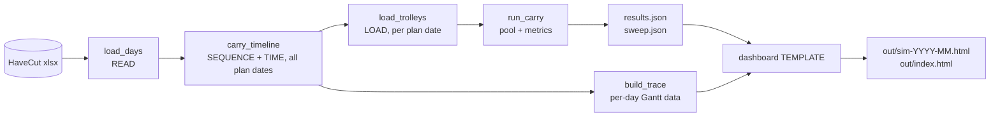

# SIM_SPEC — how the simulation computes

**For developers** who run, change or port the model. It lists every input, constant, algorithm step,
tie-break, quirk and validation number that moves a result.

- **The rules** (what the model assumes about the floor) are in [RULES.md](RULES.md). This file cites them
  by ID (H6, G6, LF3, C2.2…) and says how each one is computed.
- **The history** (dated decisions, superseded numbers, the stage-by-stage before/after) is in
  [docs/HISTORY.md](docs/HISTORY.md). This file describes the model as it is now.
- **The code wins.** If this file disagrees with `tools/`, the code is right. A behaviour marked **QUIRK**
  must be reproduced to match the published numbers, or changed deliberately with a before/after table.

**The published model, in one paragraph.** One timeline over every plan date with no cold start (§18),
on the live floor (§6b): the Job Sequence re-plans every 30 minutes, and a table starts once its plan
date, Marker Date and fabric are ready. Machines run at the G2 standard pace. Cutters lose 5 min to a
changeover and 1.5 min to moving (both ESTIMATES, Q19). S0 is the real Job Sequence and S1–S3 pair first
(§5). Loading happens per plan date (§7). The code is Node only (`tools/`).

**Scope of every number:** April–June 2026 (`WEBSITE_MONTHS`), 79 plan dates, 6,501 tables, unless a
line says otherwise. The gates and measurement scripts read the full 199-date file.

Contents

1. Input data
2. Row filters and the task record
3. Constants
4. Machines, layout and shifts
5. Stage 2 — sequencing
6. Stage 3 — timeline (spreading, cutting, blocking); 6b. The live floor
7. Stage 4 — loading (compartments, trolleys, combine, WIP hold)
8. Metrics and aggregation
9. Scenarios and the sweep
10. Task readiness status (display only)
11. Quirks that change numbers
12. Measurement scripts and their results
13. Not modelled, estimated, or missing
14. Validation targets
15. Open decisions
16. Codebase map
17. Rules Lab (the website's engine)
18. The carry-over floor

---

## 1. Input data

| Item | Value |
|---|---|
| File | `data/PPC Planning - Old Data.xlsx` |
| Sheet | `HaveCut` (68 columns) |
| Span | 199 plan dates, 2026-01-02 → 2026-08-26 (200 distinct Plan Date values on B rows) |
| Rows | 22,638 with a non-empty column A (`MO`) |
| Published scope | `WEBSITE_MONTHS = 2026-04, 05, 06` → 79 plan dates, 6,501 tables, 82.3 tables/day |
| Regression fixture only | `data/planppc.xlsx` (20 dates, 1,863 tables; `PIN_DATA_FILE`) — read only by `npm run regress`, never by a real build |

**Row types in the file**

| Type | Rows | Treated as |
|---|---|---|
| B | 15,928 | the modelled tables |
| C | 6,117 | setup added to its B table (rule G3). `Act LayerQty = 1`, `Marker Length = 1` placeholders |
| C1 | 77 | **ignored** — placeholders like C, but the code only matches `Type == 'C'` (QUIRK Q15) |
| C2 | 73 | **ignored** — same as C1 |
| T1 / T / P / R / L | 226 / 87 / 103 / 5 / 1 = 422 | excluded by J2 on purpose; real layers and lengths, so real machine time is missing |
| W | 21 | excluded; real layer counts, `Marker Length = 1` |

**Columns the model reads**

| Column | Used for |
|---|---|
| `MO` (col A) | row-exists test; combine and recall key |
| `Type` | B = task, C = setup source |
| `First Table` | `Y` excluded (5 B rows) |
| `Table No` | joins C rows to their B table; C-setup hash seed |
| `Color` | combine and recall key |
| `Batch No` | same-batch rule, batch cap, stretch status |
| `Lot` | `has_fabric` status test only |
| `Plan Date` | groups tables into days (Excel serial, date part) |
| `Marker Ratio` | pieces per size: `"XS/1,S/1,M/4,L/3,XL/2"` |
| `Act LayerQty` | pieces, spread time, cut time |
| `Marker Length` | spread time, cut time, table occupancy (treated as **yards**) |
| `Marker Date` | `has_pattern` status test only |
| `Pull Date` | actual finished-spreading timestamp: stretch status, slip statistic |
| `STYLE` | carried on the task, not used in any decision |

**Columns available but NOT used — profiled 2026-11-05 on B rows**

| Column | Filled | What it holds | Possible use in a rebuild |
|---|---|---|---|
| `Spd_Remark` | 100% | `"<colour code> <component> Graphic <letter>, <order type>"`, e.g. `00W Body Graphic A, QR` | **Component is here.** "Body" on 15,799 of 15,928 B rows (plus "OFF Body" and unparsed "Body" variants). Rule L6 is now checkable: component is effectively single. |
| `Flower` | 94% | print or graphic letter (A–Q) | matches the `Graphic` letter in `Spd_Remark` on 13,024 of 14,872 rows. A print variant: may matter for combine and cutter setup. |
| `Spd_Remark5` | 69% | spreading instruction (Vietnamese) | **Stretch spreading is explicit here:** "trải hết vải" (spread all fabric) on 2,103 rows, "trải hết batch" (spread whole batch) on 1,357, "trải đúng lớp" (exact layers) on 4,464, other 3,123, empty 4,881. The model instead *infers* stretch as the last table of a batch by Pull Date (44%). |
| `Marker Width` | 100% | fabric / marker width, 147 distinct values (e.g. 66.1) | cutter setup driver; spreading-table width check |
| `Cut Qty` | 100% | pieces cut (e.g. 770 = ratio sum 11 × 70 layers) | cross-check for `pieces = ratio × layers` |
| `Cut_Damage` | 100% | damage figure (e.g. −0.73) | yield / recut modelling |
| `Cut Date` | **2.4%** (378 B rows) | actual cut timestamp | real Pull → Cut gap: p10 27 min, **p50 82 min**, p90 313 min, never negative. A calibration sample for cutting queues. |
| `Cut EmpNo1` | 2.4% | cutting operator | — |
| `Import Date` | 100% | plan upload time | the "pattern within 1.5 h of upload" rule |
| `Sample Time`, `OK Time` | 99.7% | marker sample / approval times | pattern readiness |
| `Print Date` | 100% | marker print time | pattern readiness |
| `Paper Sample` | 100% | marker paper code (89 values) | — |
| `Marker Name` | 100% | marker id incl. style and size range | — |
| `订单类型` (order type) | 99.8% | QR 15,549 / Normal 337 / SQR 7 / empty 35 | priority rules |
| `User ID` | 100% | planner (8 users) | — |
| `Bar_Code` | 100% | table barcode | unique id |
| Size columns `4-5`…`160`, `XXS`…`4XL` | 100% | per-size ratio broken out | cross-check `Marker Ratio`; kids and number sizes (J3) |
| `Lot` | 100% | **always `1`** | carries no information |
| `Marker Bin Barcode`, `Monitor`, `Marker IN Store Date`, `Cut EmpNo2-4` | 0% | empty | — |

**Not in the data at all:** real Net_Rate; the spreading or cutting machine each table
actually ran on; fabric arrival or relax-start time; shrinkage and shade lot; trolley
dispatch and return times; compartment counts at dispatch.

## 2. Row filters and the task record

Applied in this order. Counts are for the full file.

1. Keep rows whose column A (`MO`) is truthy → 22,638.
2. Count C rows per `(plan date, Table No)` → `c_tables`. Only `Type == 'C'`, not C1 or C2.
3. Keep `Type == 'B'` and `First Table != 'Y'` → 15,923. Everything else is "skipped" (J2).
4. Drop rows where `Plan Date` is not a date.
5. Parse `Marker Ratio`: split on `,`; within each part split at the **last** `/`; trim; skip an empty count; count = integer part of the number.
6. Drop rows with an empty ratio, `Act LayerQty <= 0` or `Marker Length <= 0` → **15,920 tasks**.

**Task record**

| Field | Formula |
|---|---|
| `plan_date` | `YYYY-MM-DD` from the Excel serial. Read raw serials; `date = (serial − 25569) days` from the Unix epoch, in UTC (QUIRK Q12). |
| `universal` (`needs_trolleys`) | every size in the ratio is in the H5 film map (XXS, XS, S, M, L, XL, XXL, 3XL, 4XL). Note `2XL` is **not** in the map (J3). |
| `pieces_by_size` | `ratio[size] × layers` for universal tables; empty otherwise. **Insertion order is kept** — it decides which film opens a trolley first. |
| `setup` | if the B table has ≥1 C row: `c_setup_minutes(day, table_no)`. Multiplied by the C-row count only if `C_SETUP_PER_C_ROW` (False). Else 0. |
| `spread_minutes` | `layers × (0.80 / 8.5) × marker_length + setup` |
| `cut_minutes` | `layers × (0.40 / 8.5) × marker_length` (no setup) |
| `marker_length` | `Marker Length` as a float, in yards |
| `has_pattern` | `Marker Date` is a date |
| `has_fabric` | `Lot` and `Batch No` both non-empty |
| `spread_done_at` | `Pull Date` as a datetime |
| `order_type` | `订单类型` (QR / Normal / SQR) trimmed, `''` if empty; the last field of the task. Read only by S0's priority (§5). In the April–June data: 6,499 QR, 2 Normal. |
| `is_batch_last` | this task is the batch's table with the latest `Pull Date` **across the whole file**, not per day (QUIRK Q11) |
| `batch_first_planned` | earliest plan date of the batch, file-wide |

**C-setup hash (G3 / I3 / N):**

```
key     = "YYYY-MM-DD|" + table_key(Table No)     # integer number -> "6106"; string -> trimmed
h       = FNV-1a 32-bit over the UTF-8 bytes of key
          (offset 2166136261, prime 16777619, multiply mod 2^32 — Math.imul in JS)
tenths  = 80 + (h mod 21)                          # 80..100
minutes = tenths / 10                              # 8.0..10.0, mean 9.01
```

A non-integer numeric `Table No` must raise an error, because Python and JS spell
decimals differently. Result: 6,269 of 15,920 tasks (39.4%) carry a setup.

## 3. Constants

Every one lives in `tools/assumptions.js`. The last column is the rule in [RULES.md](RULES.md). The same
values, with every formula that uses them, are in the generated register [docs/DATA_MODEL.md](docs/DATA_MODEL.md)
(`npm run datamodel`).

| Name | Value | Status | RULES.md |
|---|---|---|---|
| `TROLLEY_COMPARTMENTS` | 5 | rule | H3 |
| `COMPARTMENT_CAP` | 150 garments | rule | H1 |
| `MAX_BATCHES_PER_TROLLEY` | 2 (never 3) | proposed rule | C2.1 |
| `TOPUP_BATCH_CAP_FROM_SCENARIO` | true: the top-up cap is `min(scenario.max_batches, 2)`; false = the old global cap, kept only for `npm run beforeafter` | rule | C2.3 (Q1) |
| `MAX_TROLLEYS_PER_COMBINE` | 4 | rule | H8 |
| `TROLLEY_BAYS` | 52 (13 spreaders × the 4 trolleys of H7) | rule | H7, C3.6 |
| `FLEET_SIZE` | 1,200 | fact | B4 |
| `CYCLE_DAYS_ALLOWED` | 5 (1 + 3 + 1) | allowance | B5 |
| `CYCLE_DAYS_ESTIMATED` | 7 | **ESTIMATE, never timed** | B6, E1 |
| `WIP_HOLD_MINUTES` | 60 | proposed | C3.2 |
| `WIP_HOLD_ANY_WORKSTATION` | true | proposed (open question) | C3.4 |
| `WIP_HOLD_MATCH_ON` | (mo, color, film_size) | proposed | C3.3 |
| `FILM_SIZE_BY_GARMENT_SIZE`, `UNIVERSAL_SIZES` | XXS/XS/S → 90; M/L → 100; XL/XXL/3XL/4XL → 110 | substitute for Net_Rate | H5, E8 |
| `TASK_STATUS_COLORS`, `TASK_STATUS_NOT_SIMULATED` | the 8 status colours (§10) | display only | — |
| `RELAX_HOURS` | 24 | rule | R3, K1 |
| `RELAX_ARRIVAL_LEAD_MIN_H` / `RELAX_ARRIVAL_LEAD_MAX_H` | 12 / 48 h before the batch's first plan date | **ESTIMATE** | R4, E4 |
| `CUT_GROUPS_BY_CUTTER_COUNT`, `SIM_CUTTER_COUNTS` | 5/6/7/8 cutters (§4); engine and measurement scripts only | 5 = floor | F2 |
| `CUTTER_COUNT`, `CUT_GROUPS` | 5, the 5-cutter groups | floor | F2 |
| `FLEXIBLE_CUT` | 24-03 → [24MC1, 24MC2]; 24-05 → [24MC2, 24MC3] | rule | F8 |
| `NIGHT_SHIFT_SPREADERS` / `NIGHT_SHIFT_CUTTERS` | 24-01/02/03 / 24MC1 | rule | F5–F7 |
| `SHIFT_START_MINUTE` | 435 (07:15 = t 0) | measured | B1 |
| `DAY_SHIFT` | (0, 765) = 07:15–20:00 | measured | B1 |
| `NIGHT_SHIFT` | (645, 1305) = 18:00–05:00 | measured | B2 |
| `DAY_BREAKS` | (270, 330), (600, 630) = 11:45–12:45, 17:15–17:45 | measured | B1 |
| `NIGHT_BREAKS` | (885, 915), (1125, 1155) = 22:00–22:30, 02:00–02:30 | measured | B2 |
| `BREAKS_STOP_MACHINES` | true | **unconfirmed** | T2, E9 |
| `SPREADING_TABLE_LENGTH_M`, `YARDS_PER_METRE`, `SPREADING_TABLE_LENGTH` | 21.2 m × 1.0936133 = 23.18 yd | **measured**, one value for all 13 | B3, G6 |
| `LAB_TABLE_LENGTHS_M` | 21.2 / 24 / 27 m; engine checks only (no page control since 2026-11-16) | hypothetical lengths | — |
| `LAY_NEEDS_FULL_LENGTH` | true (declared; the code always needs the full length) | conservative | G6 |
| `MACHINE_FILL_TARGET` | 0.70 (used by `pick_machine`: S1–S3; the real Job Sequence has none) | heuristic | C1.4, E10 |
| `ORDER_TYPE_PRIORITY`, `ORDER_TYPE_PRIORITY_DEFAULT` | SQR 0, QR 1, Normal 2 (default 2) | **ESTIMATE**: the SQL's commented-out older rule (L1016-1076) | JS3, E6 |
| `SPREAD_MIN_PER_LAYER_PER_YARD` | 0.80 / 8.5 = 0.09412 | rule | G2 |
| `CUT_MIN_PER_LAYER_PER_YARD` | 0.40 / 8.5 = 0.04706 | rule | G2 |
| `REQUIRED_PIECES_PER_DAY` | 100,000 | requirement | B7 |
| `LIVE_FLOOR` | true (false = the floor of 2026-11-09, `npm run beforeafter` only) | published | A6 |
| `REPLAN_MINUTES` | 30 | rule | LF1 |
| `PLAN_HORIZON_HOURS` | 24 | rule | LF2 |
| `C_SETUP_MINUTES_MIN_TENTHS` / `C_SETUP_MINUTES_MAX_TENTHS` | 80 / 100 | **ESTIMATE** | G3, E7 |
| `C_SETUP_HASH_OFFSET` / `C_SETUP_HASH_PRIME` | 2166136261 / 16777619 | algorithm | — |
| `C_SETUP_PER_C_ROW` | false | decision | G3 |
| `CUT_SETUP_MO_COLOR_MINUTES` | 5 | **ESTIMATE**, cutters only | T3, E2 |
| `CUT_TRAVEL_MINUTES` | 1.5 | **ESTIMATE**, cutters only | T4, E3 |
| `PULL_AHEAD_DAYS` | 1 | Rules Lab add-on value only | C4.1 |
| `LAB_SHIFT_OPTIONS` | both / day / night | Rules Lab option | C4.2 |
| `WEBSITE_MONTHS` | 2026-04, 05, 06 | scope | SIM10 |
| `DATA_FILE`, `DATA_SHEET` | `data/PPC Planning - Old Data.xlsx`, `HaveCut` | input | — |
| `PIN_DATA_FILE` | `data/planppc.xlsx` (the 20-date fixture; read only by `npm run regress`) | input | — |

There is **no machine speed constant** (T1): spreading and cutting minutes are the G2 rates above.

## 4. Machines, layout and shifts

**Cut groups (F2) at each cutter count.** `24MC1` keeps 24-01/02/03 at every count.

| Cutters | Groups |
|---|---|
| **5 (floor)** | 24MC1: 01/02/03 · 24MC2: 04/05 · 24MC3: 06/07 · 24MC4: 08/09/10 · 24MC5: 11/12/13 |
| 6 | MC1: 01/02/03 · MC2: 04/05 · MC3: 06/07 · MC4: 08/09 · MC5: 10/11 · MC6: 12/13 |
| 7 | as 6 but MC6: 12 · MC7: 13 |
| 8 | MC1: 01/02/03 · MC2: 04/05 · MC3: 06/07 · MC4: 08/09 · MC5: 10 · MC6: 11 · MC7: 12 · MC8: 13 |

The spreader order everywhere is the insertion order of these groups (24-01 … 24-13).
It decides every tie (section 11).

**Working spans** (minutes from 07:15). The start is `min(shift start, 0)`, the end is the
shift's end, minus the breaks that fall inside.

| Machine | Spans | Staffed minutes |
|---|---|---|
| Day-only spreader or cutter | [0,270] [330,600] [630,765] | **675** |
| 24-01/02/03, 24MC1 | [0,270] [330,600] [630,885] [915,1125] [1155,1305] | **1,155** |

The night shift starts at 18:00 (`NIGHT_SHIFT = (645, 1305)`, B2). In the published model the start has
no effect: the night machine's window simply runs on from 07:15 to 05:00 (`working_intervals` takes
`min(NIGHT_SHIFT[0], 0)`). It only sets the Lab's "Night only" option, where a night machine is staffed
600 min a day.

**`occupy(spans, start, minutes)`**: snap `start` forward to the next span, then consume
`minutes` span by span, jumping over gaps. The carry-over timeline appends enough synthetic staffed days
(§18) that the spans never run out. Returns `[began, end]`.

## 5. Stage 2 — sequencing

On the live floor (§6b) the sequencers run at every 30-minute re-plan (LF1), one plan date at a time,
around what the machines still have committed. `sequence(tasks, mode, layout, initLoad, initCut, moOneGroup)`
routes:
- `today` → `sequenceJobSeq` (S0, the real Job Sequence, A7);
- `moOneGroup` on → `sequenceMoAware` (the option "Keep an MO on one cut group", C1.5; scenario field
  `mo_one_group`, default off);
- otherwise → `sequencePairs` (S1–S3, rule (a), C1.1–C1.4);
- `today_grouped` → `sequenceToday`: the model's own S0 until 2026-11-09, kept only for `npm run beforeafter`.

The output is `plan[machine] = ordered list of tasks`.

**`pick_machine(candidates, load, work)`**:
1. Among `candidates`, those with `load + work <= staffed × 0.70` → the one with the least load.
2. Otherwise, any of the 13 spreaders with that room → the least loaded (QUIRK Q8: the table can leave its cut group).
3. Otherwise, the spreader with the lowest `load / staffed`.

Ties go to the first in spreader order.

**Mode `today` (S0, the real Job Sequence, `sequenceJobSeq`; `data/SQL Job Sequence Logic.sql`, `P_Task_Calculate`, core loop only, mirrored as written; the SQL's pairing switch is off, priority is the old commented rule, the 21.2 m table is kept):**

*Pass 1: every table gets a cutter (SQL L2105-2344).*
1. Tables in order of priority (`order_type`: SQR 0 < QR 1 < Normal = anything else 2, `ORDER_TYPE_PRIORITY`, an ESTIMATE), then plan order (row order of the date).
2. `spreadCount[c]` = Σ over spreaders of `1 / (cutters the spreader maps to)`, each spreader counted against its **fixed** cutter (`FLEXIBLE_CUT` gives 24-03 and 24-05 two cutters): 24MC1 2.5, 24MC2 1.5, 24MC3 2, 24MC4 3, 24MC5 3 (L1822-1834). `raw[c]` starts as the sum of `machineLoad` (the committed backlog, `initLoad`) of c's fixed spreaders, unweighted.
3. A table goes to a cutter that already holds a table of the **same MO + batch** this date, if there is one; otherwise to any cutter. Among those, the least `raw[c] / spreadCount[c]` (first cutter wins ties). Then `raw[c] += spread_minutes`.

*Pass 2: machine first (SQL L3693-, L4151-5258).* Until all tables are placed:
4. The spreader with the least `machineLoad` (**not divided by its shift minutes**; first in order wins ties) takes the next table.
5. Candidates: tables not yet placed whose cutter that spreader feeds (its primary, or the second cutter of 24-03 / 24-05). If there are none, all unplaced tables (SQL case 6).
6. It takes the one with the lowest `(priority, spread_minutes, plan order)`: **the shortest spreading time first**. The SQL's comment says "first table of the machine: shortest, then the one closest to the cutter's gap", but the code resets `@IsFirst` to 1 on every pass (L3715) and case 1 (L3889-3965) always finds a table first, so the gap term never runs (Q20). Mirrored as written.
7. `plan[m].push(table)`, `machineLoad[m] += spread_minutes`.

There is **no `pick_machine`**: no 0.70 fill target and no spill to other groups (the SQL has neither). No changeover or moving in the plan: the floor physics (`carryTimeline`: G6 21.2 m, changeover 5 / moving 1.5, `FLEXIBLE_CUT` earliest-free cutter, breaks, carry-over) run the plan unchanged. **Not modelled (no data in HaveCut, or out of scope): material and roll readiness, pull-later / merged-pull / merged-batch links, PadPrint / small-order / abnormal / first-bed machine flags, marker width, rush inserts, table locks, the same-MO same-batch switch (`SameBatchMoTogether`, off today), the 22-minute default cut, the SQL's cutter overwrite after the loop (L10363, L11639; probably a bug), and the SQL's 2-lay limit per spreading table (the measured 21.2 m is kept).**

**Mode `today_grouped` (`npm run beforeafter` only):**
1. Cluster by `(MO, colour, batch)`, keeping first-seen order.
2. Sort clusters by total `spread_minutes`, descending (stable).
3. For each cluster: cut group = `argmin(group_load / spreaders_in_group)`. Then sort its tasks by `spread_minutes` descending and place each one with `pick_machine(group's spreaders)`. Each placement updates the machine load and the group load.

This **scatters** a cluster across the group's machines.

**Modes `same_batch` (S1) and `cross_batch` (S2, S3)**: Change 1, rule (a) (`sequencePairs`; C1.1–C1.4):
1. Cluster by `(MO, colour)`, keeping first-seen order. Sort clusters by total spread, descending (this only sets the tie order of the units).
2. Within a cluster, sort by `(str(batch) ascending, spread_minutes descending)`.
3. Pass A, same batch: for each i, pair it with the first later j of the same batch where `can_combine(i, j, cross=True)` succeeds.
4. Pass B, different batch (`cross_batch` only): the same, for different-batch pairs. `same_batch` skips this pass entirely.
5. Unpaired tasks become single units. **All units of the whole day go into one list**, sorted by spread, descending (a pair counts as one unit, its work = both tables).
6. Each unit goes to the cut group with the smallest **busier side**: `max((group spread load + unit spread) / group spreader minutes, (group cut load + unit cut) / cutter minutes)`. The cut load starts from `initCut`, what each cutter still has to cut at the day's start in staffed minutes (the real cutter backlog, `carryTimeline`). Then `pick_machine(group, work = unit spread)` picks the spreader, and **both tasks of a pair are appended consecutively** (back-to-back on one spreader). Pairs of one MO + colour are therefore spread over the floor.
7. The loads are credited to the machine's **real** cut group (`primary_cut[machine]`), because `pick_machine` can leave the chosen group (Q8). The cut-side credit goes to the spreader's primary cutter although `FLEXIBLE_CUT` lets 24-03 and 24-05 use a second cutter: an **approximation kept on purpose** (the timeline still picks the freer cutter).

**The option "Keep an MO on one cut group"** (`sequenceMoAware`, C1.5; scenario field `mo_one_group`,
Lab option `moOneGroup`) is steps 1–5 above, then the cut group is chosen **once per cluster** =
`argmin(group_load / n)` and every unit of the cluster is placed with `pick_machine(group, …)` in that
group. It is case 2 of `npm run beforeafter`; S0 ignores it.

**`can_combine(a, b, cross)`** (used in sequencing and in loading):
- `null` if either table is non-universal;
- or MO differs, or colour differs;
- or batch differs and not `cross`;
- or `trolleys_for(combined_compartments(a, b)) > 4`.

Otherwise it returns the combined compartments. It does **not** check film, component
or workstation (QUIRK Q2).

## 6. Stage 3 — timeline (spreading, cutting, blocking)

This section is the per-table physics, shared by both floors. The published model dispatches it through
the live floor (§6b); `A.LIVE_FLOOR = false` dispatches it once a day (the floor of 2026-11-09, §18,
`npm run beforeafter` only).

One timeline runs over **every plan date** (§18 for how the dates chain; R5: no empty start). State per spreader: `free` (when it is next free), `lays` (a list of
`[length, table_free_from, cut_end]`). State per cutter: `cutFree` and `lastCut` (MO, colour, spreader
of its last cut), both carried across plan dates.

For each table, taken from the spreader with the earliest next staffed instant (§18 step 5):
1. **G6 room:** `start = room_at(lays, 23.18 yd, eff, marker_length)`, `eff` = the spreader's next staffed instant. This is the earliest time `free_length >= marker_length`, found by scanning the lays' marks, then a 40-step bisection; it falls back to the latest `cut_end`.
   `free_length(t) = table − Σ used(lay)`, where `used` = the full length if `t <= table_free_from`, 0 if `t >= cut_end`, and `length × (cut_end − t) / (cut_end − table_free_from)` in between. **The cutter frees length linearly.** Lays that ended before `eff` are dropped from the list.
2. `blocked = staffedBetween(spreader spans, eff, start)`: staffed minutes only.
3. `[spread_start, spread_end] = occupy(spreader spans, start, spread_minutes)`; `free = spread_end`.
4. **Cutter:** `flex = FLEXIBLE_CUT[machine]` or `[primary cutter]`; pick the one with the smallest `cutFree` (tie → list order). `cut_wait = max(0, spread_end − cutFree)`.
5. **Changeover and moving (Q19, ESTIMATES):** `setup = CUT_SETUP_MO_COLOR_MINUTES` (5) if the cutter has a last cut and its MO or colour differs from this table's (compared as strings), else 0; `travel = CUT_TRAVEL_MINUTES` (1.5) if the cutter has a last cut and it was on a different spreader than this table's, else 0. Both are added **left to right on top of the G2 cut minutes**: `[cut_start, cut_end] = occupy(cutter spans, max(spread_end, cutFree), cut_minutes + setup + travel)`. Then `cutFree = cut_end`, `lastCut = (mo, colour, machine)`.
6. Push `[marker_length, min(cut_end, cut_start + setup + travel), cut_end]` onto the spreader's lays. Stamp the task with `machine, cutter, spread_start, spread_end, cut_start, cut_end, blocked_minutes, cut_wait, cut_setup_minutes, cut_travel_minutes`.

Spreaders have only their own colour-change setup (the Type C row setup, inside `spread_minutes`):
no extra spreader changeover or moving (T6). There is no end allowance per lay and no limit on how long
a lay waits.

**Per-plan-date aggregates** (means of the daily values): see §18.

## 6b. The live floor — the published timeline (`tools/floor.js`, `A.LIVE_FLOOR = true`)

Rules A5–A6 (R1–R4, LF1–LF4). One shared core, `Floor.run()`, is called by `model.js` (`carryTimeline`,
live branch) and by the Lab engine, so they share the timeline by construction (Lab = model is still
asserted on everything around it). The per-table steps of §6 (G6 21.2 m, staffed spans, changeover 5 /
moving 1.5, `FLEXIBLE_CUT`) are the same.

**Readiness** (`rel`, minutes on the run's clock; a table starts at or after it):
`max(plan date's 07:15 (earlier with pull-ahead), 07:15 + marker_rel, fabric)`. `marker_rel` = `Marker
Date` as minutes after the table's own plan date's 07:15 (a timestamp in the data; always before the
actual spread time, `Pull Date`; 79% of tables have it after their plan date's 07:15, 12% on the next
day). `fabric` = the relaxing ESTIMATE: the batch's fabric arrives 12–48 h (a fixed hash per batch) before
its first plan date in the file, then relaxes 24 h. Fabric and marker are ESTIMATES in how they are used
(the data has no arrival or relax-start time).

**Events, in time order** (ties: re-plan, then cutters in order, then spreaders in order):
1. **Re-plan**, every `A.REPLAN_MINUTES` (30) from the first plan date's 07:15, around the clock. Every
   ready table not yet started (oldest plan date first) is taken until its spreading minutes fill the
   spreaders' staffed time of the next `A.PLAN_HORIZON_HOURS` (24, all shifts). The scenario's Job
   Sequence (`sequence()`, unchanged) plans them **one plan date at a time**, each date around the loads
   left by the dates before it: `init[m]` = staffed time of the spread in progress, `initCut[c]` = staffed
   time of the cut in progress plus the cut minutes of lays waiting for c's group.
2. **A spreader starts the head of its queue** at the earliest staffed instant where the lay fits (G6). A
   lay not yet cut holds its full length; a re-plan that changes the head cannot start it earlier than
   the re-plan.
3. **A cutter that is free takes the waiting lay that has waited longest** (earliest spread end) among the
   spreaders it serves (own group plus the second cutter of 24-03 / 24-05). Ties: earlier spreader, then
   earlier table. Setup and moving as before (Q19). This rule is an ESTIMATE.

**A pair stays together** (LF3, rule (a); the SQL locks tables processed together): S1–S3 only. When the
first table of a pair starts on a spreader, its partner (the next table of that queue that `canCombine`
with it: same MO, colour, film, ≤ 4 trolleys; same batch unless cross-batch) is pinned as that spreader's
next table and is not re-planned.

**Not modelled:** the SQL's table locks (first 2 tables per spreader), material and rolls, rush inserts.

## 7. Stage 4 — loading (compartments, trolleys, combine, WIP hold)

**`compartments_for(pieces_by_size)`** → an ordered map `film → [compartment quantities]`.
Walk the sizes in insertion order: `full, rem = divmod(qty, 150)`; push `full × 150`,
then `rem` if non-zero. Sizes are **never merged** across sizes: one compartment holds
one size (H1).

**`trolleys_for(comps)`** = `Σ over films ceil(len(list) / 5)`. One trolley holds one film.

**`combined_compartments(a, b)`**: if the batches are the same, merge pieces size by size
and then compute compartments (same-size remainders merge up to 150). If the batches
differ, concatenate each table's own compartments per film.

**Loading events** (per machine, walking the plan order):
- A non-universal task is skipped.
- If `can_combine(seq[i], seq[i+1], scenario.cross_batch)` succeeds: one event with the combined compartments, batches {a, b}, `when = max(cut_end_a, cut_end_b)`, table = a; advance 2.
- Otherwise: a single event, `when = cut_end`; advance 1.
- `cross_batch = max_batches >= 2`. Pairing is greedy and non-overlapping on the **adjacent** tables only.
- Sort all events by `when` (stable).

**`load_trolleys`**, for each event in time order:
1. If the event has more than one batch, `combines += 1` (QUIRK Q3: same-batch combines are not counted).
2. **Expire:** for every parked trolley, keep it if `when − parked_at <= hold`; otherwise record the wait and drop it (dispatched).
3. For each film in the event's compartments, in insertion order:
   - `compartments += n`; `pieces += Σ qty`.
   - Key = `(mo, colour, film)`, plus the machine if not `hold_any_workstation`. There is no component in the key.
   - **Top up:** for each parked trolley under the key, in order: skip it if the batches would exceed `min(scenario.max_batches, MAX_BATCHES_PER_TROLLEY)` (Q1, fixed 2026-11-14 by `A.TOPUP_BATCH_CAP_FROM_SCENARIO`; `false` = the old global cap of 2); take `min(free, need)`. Remove trolleys whose `free` reaches 0.
   - **Open new:** while compartments remain: open a trolley, take `min(5, need)`, `trolleys += 1`. If it has spare compartments and `hold > 0`: park it if fewer than 52 trolleys are parked in total; otherwise `blocked_by_space += 1`.
4. Trolleys still parked at the end of the day are never expired or counted again.

`avg_wait_hours` is the mean wait of **expired** trolleys only, in hours.

## 8. Metrics and aggregation

**Per day:**

| Metric | Formula |
|---|---|
| `trolley_utilization_pct` (H6) | `100 × compartments / (5 × trolleys)` |
| `compartment_fill_pct` | `100 × pieces / (150 × compartments)` |
| `pieces_per_trolley` | `pieces / trolleys` |
| plus | the timeline aggregates from section 6 |

**Pooled over plan dates (`runCarry()` → `pool`; the loading and these metrics are per plan date, §18 step 7):**

| Metric | Formula |
|---|---|
| `utilization_pct` | `100 × Σcompartments / (5 × Σtrolleys)` (pooled, not a mean of daily %) |
| `trolleys_per_day` | `Σtrolleys / days` |
| `compartment_fill_pct` | `100 × Σpieces / (150 × Σcompartments)` |
| `pieces_per_trolley` | `Σpieces / Σtrolleys` |
| `garments_per_trolley_capacity` | `150 × Σcompartments / Σtrolleys` |
| blocked %, blocked min, overrun, machines over, makespan, `avg_wait_hours` | **mean of the daily values** |
| `peak_trolleys_in_a_day` | max |
| `fleet_required` | `trolleys_per_day × cycle_days` |
| `longest_sustainable_cycle` | `1,200 / trolleys_per_day` |
| `fleet_gap` | `1,200 − fleet_required(7 days)` |

## 9. Scenarios and the sweep

| Scenario | sequencing_mode | max_batches | wip_hold_minutes | any WS |
|---|---|---|---|---|
| S0 Today | today | 1 | 0 | — |
| S1 + same-MO sequencing | same_batch | 1 | 0 | — |
| S2 + 2 batches per trolley | cross_batch | 2 | 0 | — |
| S3 + WIP hold | cross_batch | 2 | 60 | True |

The **hold variants** are cross_batch with max_batches 2, with hold set to 0, 60 and 120
minutes, each with same-WS or any-WS recall.

The **sweep** covers mode {today, same_batch, cross_batch} × batches {1, 2, 3} × hold
{0, 30, 60, 90, 120, 180, 240} × any-WS {F, T}. When hold = 0, any-WS is forced to T.
That gives **117 scenarios**, keyed `mode|batches|hold|anyWS`.

Fleet size and cycle days are not swept. They are arithmetic on trolleys per day.

## 10. Task readiness status (display only — no effect on any number)

Evaluated in this order:
1. `completed` if the simulated `cut_end <= cursor`
2. `no_fabric` if `!has_fabric`
3. `no_pattern` if `!has_pattern`
4. `stretch` if `is_batch_last`
5. otherwise `normal`

`cut_queue`, `no_fabric_time` and `neither` never fire in this order. Colours are in `TASK_STATUS_COLORS`.
The website's Job Sequence Gantt (§17) colours a bar `no_fabric_time` when its fabric is not ready at the
time cursor, and never checks the marker.
`Spd_Remark5` (section 1) is a better stretch source than `is_batch_last`.

## 11. Quirks that change numbers

Each one must be reproduced to match the published results, or deliberately changed with a before/after table.

| # | Quirk | Effect |
|---|---|---|
| Q1 | **FIXED 2026-11-14** (user). The parked top-up used to check the **global** `MAX_BATCHES_PER_TROLLEY`, so "1 batch per trolley" with a WIP hold still mixed two batches. It now checks `min(scenario.max_batches, MAX_BATCHES_PER_TROLLEY)`. Still true: max_batches 2 and 3 give identical results (the floor's cap is 2) | only the 36 sweep keys with batches = 1 and a hold moved; the headline and the hold variants did not (stage (vi), [HISTORY](docs/HISTORY.md)). The page enables 2 and 3 batches only under Cross-batch sequencing (C2.2) |
| Q2 | `can_combine` doesn't check film, component or workstation | film is handled per compartment; component can't be checked; workstation is implied by adjacency |
| Q3 | `combines` counts only multi-batch events | same-batch combines are invisible in the count |
| Q4 | `sequence_mo_aware` (now the option "Keep an MO on one cut group") and `sequence_pairs` (the published S1–S3 pairing) call `can_combine(…, cross=True)` in both passes | the pass list, not the call, decides cross-batch pairing |
| Q5 | **Retired with the cold start** (2026-11-09). Every plan date started with empty machines at 07:15 | — |
| Q6 | **Retired with the cold start.** `occupy` ran past the last span on the raw clock | — (the carry-over timeline has synthetic staffed days, nothing runs on the raw clock) |
| Q7 | **Retired with the cold start.** Blocked minutes were counted on the raw clock | — (the carry-over timeline counts staffed minutes) |
| Q8 | `pick_machine` falls back to any spreader on the floor | a table can leave its cut group when the group is full. `sequence_pairs` credits its load to the machine's real group (`primary_cut[m]`), so the next unit is balanced on the truth |
| Q9 | Ties go to the first in iteration order (`min` semantics) | the spreader, cutter and group choice on equal values |
| Q10 | `pieces_by_size` and film maps keep insertion order (JS must use `Map` for film keys) | which film opens a trolley first once the 52 bays are full |
| Q11 | `is_batch_last` is computed across the whole file | stretch colour changes with the date range loaded |
| Q12 | Excel dates are read as raw serials | SheetJS `cellDates` is one day off on UTC+7 |
| Q13 | `cut_end` is never rounded | rounding reorders loading events and hold timing |
| Q14 | Python rounds half to even; JS doesn't | use `tools/round.js` for printed values |
| Q15 | Only `Type == 'C'` adds setup | 150 C1/C2 rows add nothing |
| Q16 | **Retired with the cold start.** Lays were never dropped from a spreader's list | — (`carryTimeline` drops lays older than the effective start; identical results) |
| Q17 | The WIP-hold key has no component | can't be enforced: no component data in the model (now readable from `Spd_Remark`) |
| Q18 | Composite keys in JS use a `\x01` separator | avoids `'AB'+'C'` vs `'A'+'BC'` collisions |
| Q19 | Cutter changeover and moving (2026-11-09, ESTIMATES 5 / 1.5 min): the spreading table stays occupied through them. The lay's table-free time is `min(cut_end, cut_start + setup + travel)` on the **raw clock**, so a break inside the changeover starts the freeing early (capped at `cut_end`). `lastCut` carries across plan dates. Spreaders have no changeover or moving, only their own C setup. Mirrored from the Lab, **documented, not fixed** | more changeover can only delay table freeing, never speed it; the cutters' output falls with it (§17) |
| Q20 | S0's "closest to the cutter's gap" rule never runs (SQL L3715, L3773-3777, L3889-3965) | every new table goes shortest spreading time first. Mirrored as written, not the intent in the SQL's comment. Whether the live system behaves differently is not known |
| Q21 | S0 balances spreaders by spreading minutes, **not divided by shift minutes**, and cutters by minutes ÷ the number of spreaders on them (1/(cutters mapped)) | the three night-capable spreaders (1,155 staffed min) get the same minutes as the day-only ones (675), and 24MC2 / 24MC3 (1.5 and 2 spreaders) are loaded about 70–74% of staffed time against about 55% for 24-08..13 and about 47% for 24-01..03 (`tools` scratch diagnostic, 2026-11-10; not reproducible by a repo script). This, not pairing, is most of the S0 → S1 difference ([HISTORY](docs/HISTORY.md), stage (iv)) |
| Q22 | S0 ties: tables with equal priority and spreading time go by plan order (row order); spreaders with equal load by spreader order | the SQL leaves ties undefined (`TOP 1` with no unique key); the model needs a deterministic rule |
| Q23 | S0's priority is an ESTIMATE (`ORDER_TYPE_PRIORITY`); the live `Job_Seq_Schedule_Priority` was not supplied. In the April–June data 6,499 of 6,501 tables are QR, so the priority hardly decides anything | S0 would change only if the live priority table does |
| Q24 | The live floor re-plans every 30 min, plan date by plan date, and the "ready" set is cut off at 24 h of spreader capacity | a spreader that empties its queue between ticks waits for the next tick; tables beyond the horizon are not planned yet |
| Q25 | The cutter's "longest wait" is an ESTIMATE of the operator's free choice | the real operator picks as they like; only the rule is modelled |
| Q26 | The Marker Date gates every table (79% have it after their plan date's 07:15) and fabric readiness is the relaxing ESTIMATE | most of the live floor's idle time is waiting for tables to become ready; both inputs are not measured as used |
| Q27 | A pair is pinned next on its spreader once its first table has started | a pair is never split by a re-plan, so the 30-min re-plan keeps rule (a) |
| Q28 | Results depend on the export's row order | S0's plan order, ties and the cutter's tie-break use row order; `npm run regress` R1 compares the two workbooks in one row order, and reports the as-loaded order too |
| — | `FLEXIBLE_CUT` approximation in `sequence_pairs`: the cut-side load of a table is credited to its spreader's primary cut group, although 24-03 and 24-05 may be cut by a second cutter (the timeline picks the freer one) | the cutter balance in the planner is slightly off for those two spreaders |

## 12. Measurement scripts and their results

None of these feeds the build or the headline. Scope is April–June unless the row says otherwise.

| Table | Script | What it adds | Result |
|---|---|---|---|
| T-C | `tools/tc_table.js` | cutter count 5–8 against trolley numbers | `npm run tc` (live floor, changeover 5 / moving 1.5 ESTIMATES, fleet at the 7-day ESTIMATE). From 5 to 6–8 cutters: S0 +0.09 to +0.15 pt utilization, fleet −3 to −4; S1 −0.06 to −0.02 pt; S2 −0.20 to +0.05 pt; S3 +0.25 to +0.44 pt, fleet −4 to −7. Spreader blocking falls from 4.1% to 1.5–1.7% (S0). The cutter count barely moves the trolley numbers |
| Ceiling | `tools/util_ceiling.js` | utilization with ideal packing and no timing (5,384 universal-size tables) | `npm run ceiling`: each table alone 51.2%; one batch per trolley, waiting all plan date 66.9%; MO + colour + film with at most 2 batches 79.5%; any number of batches 82.9%; waiting the whole period 90.7% (not real) |

| Idle time | `tools/idle_variants.js` | blocking, cut groups, routing and table-length fixes, the cutter ladder | `npm run idle`, full file (199 dates), S0. Results and their reading: [docs/IDLE_TIME.md](docs/IDLE_TIME.md) |
| Data model | `tools/data_model.js` | entities, attributes, parameters with current values, formulas, data statistics | `npm run datamodel`: [docs/DATA_MODEL.md](docs/DATA_MODEL.md) and `docs/data_model/*.csv`; `-- --check` fails if they are out of date |
| Validation | `tools/carryover_probe.js` | the model's lateness against the real Pull Date | `npm run carryprobe`, §18 |
| Before / after | `tools/before_after.js` | every published change, stage by stage, with asserts | `npm run beforeafter`, [docs/HISTORY.md](docs/HISTORY.md) |

Measurements that are no longer reproducible (cold-start tables T-B, T-E, T-F, the 2026-11-05 cutter
changeover probe) are kept in [docs/HISTORY.md](docs/HISTORY.md) and the archive.

## 13. Not modelled, estimated, or missing

| Item | Status | Direction of the error |
|---|---|---|
| Trolley round trip (7 days) | ESTIMATE (E1) | decides the whole fleet case; the fleet covers 5.89 days for S0 and 7.91 days for S3 (`longest_sustainable_cycle_days`, April–June headline) |
| Moving a parked trolley to another workstation | not modelled (C3.4) | a 1 h hold is worth +6.28 pt over no hold with any-workstation recall and +0.25 pt with same-workstation recall (hold variants, `out/results.json`) |
| Cutter changeover (5 min) | **ESTIMATE, in the published model** (T3, Q19) | MO or colour change only; marker width, graphic letter and batch changes are not triggers; not timed on the floor |
| Cutter moving between spreaders (1.5 min) | **ESTIMATE, in the published model** (T4, Q19) | not timed on the floor |
| Spreader changeover and moving | not modelled (T6; only the Type C setup) | real spreaders lose some time to both |
| Machine speed | G2 standard pace, no speed factor (T1) | the model is less late than the real floor (25.98% of tables late against 51.25%, `npm run carryprobe`): something slows the real floor that the model does not have |
| Lay end allowance | not modelled | real blocking is higher |
| Progressive spreading (`LAY_NEEDS_FULL_LENGTH`) | conservative | real blocking is lower |
| Different table lengths per machine | one value for all | — |
| Breaks stop machines | unconfirmed | ±150 min per machine per day |
| C-table setup 8–10 min | ESTIMATE (E7) | small (0.06 pt on the retired cold-start model; not re-measured) |
| T1/P/T/R/L/W rows (443) | excluded | machine load under-counted |
| Kids and number sizes (J3) | no compartments | trolleys/day conservative: ~60,200 pieces/day reach trolleys in Apr–Jun (the 20-date export: ~68,700 of ~90,000) |
| Net_Rate | substituted by H5 | utilization conservative |
| Component | absent in the model; present in `Spd_Remark` | ~single "Body" component |
| Fabric arrival | ESTIMATE (R4, E4) | the data has no arrival or relax-start time; the arrival window decides when part of the tables can start (§6b) |
| Actual machine per table | absent | the sequence can't be validated against the floor |
| Trolley pool | unlimited | the S0 shortage never throttles output in the model (about 12% if it did, on the retired cold-start model; not re-measured) |
| Loading labour and transport | not modelled | the fewer trolleys a day (S0 203.8 → S3 151.7, April–June) are not converted to hours |
| Multi-day state | carry-over floor (§18) | machines and cutters carry work across plan dates; **loading** does not (parked trolleys do not carry into the next date) |
| Shrinkage and shade lot | absent | batch merging at spreading untested |

## 14. Validation targets

**Data** (full file): 22,638 rows · 15,928 B · 15,923 after the First Table test · **15,920 tasks** · 6,269 with a C setup (mean 9.0088 min).

**Headline, April–June** (79 dates, 6,501 tables, 5 cutters, 21.2 m; live carry-over floor, G2 standard
pace, cutter changeover 5 min and moving 1.5 min (ESTIMATES), S0 = the real Job Sequence, pairs rule for
S1–S3; the fleet row is at the 7-day trip, an ESTIMATE). Full-precision source: `out/results.json`
(`npm run beforeafter` asserts that its last stage equals it). Rounded here:

| | S0 | S1 | S2 | S3 |
|---|---|---|---|---|
| utilization_pct | 51.85 | 58.19 | 61.17 | 67.45 |
| trolleys_per_day | 203.8 | 175.8 | 167.3 | 151.7 |
| peak trolleys | 317 | 277 | 254 | 244 |
| fleet @ 7 days | 1,426 | 1,231 | 1,171 | 1,062 |
| against 1,200 owned | 226 short | 31 short | 29 spare | 138 spare |

Cutter output, April–June (`npm run lab`, Rules Lab engine): real plan (80,833 pieces planned a day) S0
80,216, S1 80,222, S3 80,211 pieces cut a day; 100k plan S0 96,700, S1 96,576, S3 97,119. Earlier
headlines and how they moved: [docs/HISTORY.md](docs/HISTORY.md).

**Gates** (all must pass before anything is published, SIM11):
- `npm run lab`: Lab = model, exactly (§17).
- `npm run regress`: 18 shared dates × 117 scenarios = 33,696 checks, on `runCarry()`; a reader check
  of the 20-date export against the 199-date workbook.
- `npm run parity`: the page, in Edge, re-runs what Node computed (option sets, all 117 sweep keys,
  each month's trace).
- The Edge check: open the page; no console errors, the badge green on the defaults, the controls work.
- `npm run beforeafter`: every stage reproduces its frozen headline and the last stage equals
  `out/results.json` (asserts listed in [docs/HISTORY.md](docs/HISTORY.md)).

`out/*.bak` are the last output of the retired Python build. Never edit them; no gate reads them.

## 15. Open decisions

Decided items are in [docs/HISTORY.md](docs/HISTORY.md).

1. **Trolley pool.** Limit it to 1,200, with a return delay = cycle time, so a shortage can stop cutting?
2. **Data upgrades.** Read component from `Spd_Remark`, stretch from `Spd_Remark5`, and setup from C1/C2. Decide whether to admit T1/P/T/R/L/W rows.
3. **Validation.** `npm run carryprobe` compares the model's lateness with `Pull Date` (nothing is tuned to it); the 378 `Cut Date` rows give the Pull → Cut gap (median 82 min), not yet used. Open: what slows the real floor.
4. **Quirks.** Decide which of Q2–Q4, Q8–Q15, Q17–Q28 to keep for continuity and which to fix, each with a before/after table (Q1 is fixed; Q5–Q7 and Q16 are retired).
5. **S0 → S1 is two changes** (a different dispatcher and pairing). A one-rule S1 (S0 with the SQL's own `SameBatchMoTogether` switch on) would separate them.
6. **Real relaxing data and relaxing trolleys** (Rulebook B.2, C.a, C.b, Q.1). The rulebook asks for fabric
   relaxing to be simulated with spreading and cutting, including relaxing trolleys (6 rolls, at most 2
   colours), the 2 feed positions per spreader, and a partly relaxed batch holding its tables back. Today
   fabric arrival is an ESTIMATE per batch (R4). A sample with real relaxing start and end per batch and roll
   exists (`RelaxingInfo - Sample.xlsx`, in the Panel Loading Pilot folder outside this repo; join on So_No =
   the first 9 characters of MO, J6). Reading it, and modelling the trolleys and feed positions, is a model
   change with a before/after table.
7. **Floor measurements still needed:** trolley round trip, how a trolley moves between workstations, changeover and moving minutes, fabric arrival times, whether breaks stop machines, per-table lengths.

## 16. Codebase map

### Data flow



**The code is Node only.** `tools/` is the model and produced everything in `out/`. This spec uses
snake_case function names in places (from the retired Python copy); `model.js` uses the camelCase forms.

### Model files

| File | Role | Key functions |
|---|---|---|
| `tools/assumptions.js` | every constant (§3) | — |
| `tools/model.js` | the 4 stages + metrics | `workingIntervals`, `machineLayout`, `occupy`, `makeScenario`, `parseMarkerRatio`, `fnv1a32`, `cSetupMinutes`, `loadDays`, `compartmentsFor`, `trolleysFor`, `combinedCompartments`, `canCombine`, `pickMachine`, `sequence(tasks, mode, layout, initLoad, initCut, moOneGroup)`, `sequenceJobSeq` (S0), `sequenceToday` (`today_grouped`), `sequenceMoAware` (the option "keep an MO on one cut group"), `sequencePairs` (S1–S3), `freeLength`, `roomAt`, `loadingEvents`, `loadTrolleys`, `pool`, `staffedBetween`, `carryTimeline(days, mode, layout, tableLength, moOneGroup)`, `runCarry`, `fleetRequired`, `longestSustainableCycle` |
| `tools/floor.js` | the live floor's event-driven timeline (§6b), shared by `model.js` `carryTimeline` (live branch) and the Lab engine, inlined into the page before `lab.js` | `run`, `roomAt`, `freeLength`, `advance`, `occupy`, `staffedBetween` |
| `tools/lab.js` | the Rules Lab engine (§17), run by Node and inlined into the page | `makeConfig`, `createEngine` (`run`, `run100k`, `rebucket`), `ladder`, `summary`, `optFromSweepKey`, `decode` |
| `tools/scenarios.js` | S0–S3, hold variants, 117-row sweep | `HEADLINE`, `HOLD_VARIANTS`, `sweepKey`, `sweepScenarios` |
| `tools/daytrace.js` | per-day trace and the Lab's compact data | `SIM_VARIANTS`, `buildTrace`, `labInput`, `labData` |
| `tools/build.js` | orchestrates the build, writes `out/` and the root `index.html` | `buildPayload`, `extractTemplate`, `buildDashboardHtml`, `labBlock` |
| `dashboard.py` | the page: HTML + CSS + browser JS. Python is not needed: `build.js` reads `TEMPLATE` out of it as text | see below |
| `tools/round.js` | Python-style banker's rounding for printed values (Q14) | `bankersRound` |

**Dependency order inside `tools/model.js`:** `assumptions` → `working_intervals` → `machine_layout`
→ `LAYOUT` (the default 5-cutter layout). Every stage takes an optional `layout` and
`table_length`, so variants never mutate module state.

### Build outputs

| File | Built by | Contents |
|---|---|---|
| `out/results.json` | `build.js` | keys: `plan_dates`, `tables`, `assumptions`, `cut_groups`, `night_shift_*`, `spreader_shift`, `cutter_shift`, `machine_minutes`, `shift_end`, `table_lengths_m`, `status_colors`, `headline` (S0–S3 summaries), `hold_variants`, `sweep`, `sweep_axes`, `per_day`, `sim_variants`, `cutter_counts`, `cut_groups_by_cutter_count`, `cutter_*_by_cutter_count`, `slip`, `baseline_variant` |
| `out/sweep.json` | same | the 117 sweep rows (the badge's published values) |
| `out/sim-2026-0{4,5,6}.html` | same | one self-contained page per month: the same pooled Lab data plus that month's trace |
| `out/index.html` | same | a copy of the chronologically latest month. `build.js` also copies it to the repo root `index.html`, because GitHub Pages serves the root |
| `out/*.bak` | the last Python run (retired model) | kept on disk, **never edit**; no gate reads them |

**Trace shape** (`build_trace`), per date × sequencing mode × variant:
- `order[machine] = [task index…]`. This lives inside the variant, because the cutter count changes the sequence.
- `time = {ss, se, cs, ce, cut}`: parallel arrays. `ce` is unrounded; the rest are rounded to 1 decimal place.
- `expected`: the model's own loading result, used by the parity gate.
- `blocked` and `groups`: the idle-time aggregates.

Full variants are 21.2 m at 5 and 7 cutters. Aggregate-only variants are 6 and 8 cutters, and 24 m and 27 m tables.

### The page (`dashboard.py` `TEMPLATE`)

**One page: the Rules Lab** (§17). The page runs `tools/lab.js` + `tools/floor.js` inlined by `build.js`,
the very files Node runs, so there is one implementation of the loading stage in the project.

- **Top level:** `DATA`, `state` (`cycle`, `fleet`: the Fleet sliders), `key`, `trolleySvg`, `fleetDial`, the theme button.
- **Rules Lab (`LABUI`):** `syncControls`, `tiles` (fleet card + six tiles), `trolleyPanel` ("What one trolley looks like"),
  `badge`, `machineTables` (`sumTable`, `eachTable`), `outputs`, `dayChart`, `ganttSvg` (rows from `rowsOf`/`groupsOf`),
  `idleTable`, `loadPanel`, `render`, `wire`, `show`, `__labCheck`.
- **Parity hook:** `window.__LAB.__labCheck()` re-runs the option sets Node precomputed, all 117 sweep keys,
  and this month's trace.

### Gates and measurement scripts

| Command | Script | Kind | What it checks or produces |
|---|---|---|---|
| `npm run build` | `tools/build.js` | build | everything in `out/` (needs a 6 GB heap, ~24 s) |
| `npm run lab` | `tools/lab_table.js` | **gate** | Rules Lab = model, exact (§17); also prints the comparison tables; `-- --checks` for the checks only |
| `npm run regress` | `tools/regress.js` | **gate** | R0–R3: 18 shared dates × 117 scenarios = 33,696 checks on `runCarry()`, old file against new (a reader check, not a check against Python) |
| `npm run parity` | `tools/parity_check.js` | **gate** | opens each month file in Edge (`playwright-core`) and runs `__LAB.__labCheck()` |
| `npm run idle` | `tools/idle_variants.js` | measurement | idle-time tables ([docs/IDLE_TIME.md](docs/IDLE_TIME.md)), 199 dates |
| `npm run tc` | `tools/tc_table.js` | measurement | T-C, the cutter count against trolley numbers (§12) |
| `npm run beforeafter` | `tools/before_after.js` | measurement + asserts | the staged before/after ([docs/HISTORY.md](docs/HISTORY.md)); exits non-zero if a stage misses its frozen headline or the last stage differs from `out/results.json` |
| `npm run carryprobe` | `tools/carryover_probe.js` | measurement | the model's lateness against the real Pull Date: a validation, not a calibration (§18) |
| `npm run ceiling` | `tools/util_ceiling.js` | measurement | trolley-utilization ceilings with perfect packing and unlimited waiting (A–E, §12) |
| `npm run datamodel` | `tools/data_model.js` | generated doc + check | [docs/DATA_MODEL.md](docs/DATA_MODEL.md) and its CSVs; asserts every constant is documented; `-- --check` exits 1 if out of date |

**Dependencies:** Node with `xlsx` 0.18.5 (SheetJS) and `jsdom` (both dev-only), plus
`playwright-core` with the installed Edge for parity. No Python.

**Agents:** `.claude/agents/` defines planner → coder → tester, plus a compacter that records decisions in
[docs/HISTORY.md](docs/HISTORY.md).

### Known code debts

- Two rows of the old sensitivity table (chaining more than two tables per trolley set) need a
  `max_chain` field on `Scenario` to regenerate ([RULES.md](RULES.md) F).

### Suggested rebuild order

1. Port `assumptions` and the READ stage. Check the data counts against section 14.
2. Port the shifts and `occupy`. Check the 675 / 1,155 staffed minutes.
3. Port SEQUENCE and TIME. Check S0 blocked minutes against section 14.
4. Port LOAD. Check all four headline columns to full precision.
5. Port the sweep. Run regress-style checks on the 18 shared dates.
6. Only then add any of the decisions in section 15, each with a before/after table.


## 17. Rules Lab (the website's engine)

The website is one page, the Rules Lab (`dashboard.py` `TEMPLATE`). Its engine is **`tools/lab.js`**: one
dependency-free file that Node runs and that `build.js` inlines into the page together with
`tools/floor.js`, so the page and Node run the same code. `tools/model.js` is the independent reference
the Lab is checked against.

**On its defaults the Lab is the published model:** live carry-over floor, G2 standard pace, the pairs
rule, cutter changeover 5 min and moving 1.5 min (ESTIMATES, part of the floor), fabric relaxing on,
the published recall order. It runs all 79 plan dates on unrounded inputs, so its numbers equal the
published sweep (S0–S3 and all 117 sweep keys) and its Job Sequence equals the model's trace. The badge
is green when the current selection is a published sweep key and matches it; any other setting turns it
to "Not the published model" and lists what differs.

**S0 against the selection (SIM5).** Every comparison row runs on the same floor. Shift, fabric
relaxing, cutter setup and travel come from the selection, so S0 carries them too; only the rules differ.

**Page controls → engine options**

| Page control | Option | Values | RULES.md |
|---|---|---|---|
| Shift | `shift` | `both` (default), `day`, `night` | C4.2 |
| Round trip, Trolleys owned | page state `cycle`, `fleet` | 3–10 days (7), 600–2,200 (1,200); arithmetic only, no re-run | KPI4, KPI5 |
| Same-MO sequencing | `seqMode` | `today` (Off), `same_batch`, `cross_batch` | C1.1 |
| Where the pairs go | `moOneGroup` | pairs over the floor (default) / keep an MO on one cut group; only with same-MO sequencing on | C1.5 |
| Batches per trolley | `batches` (`mix = batches ≥ 2`) | 1, 2, 3; 2 and 3 are enabled only with `cross_batch`, and leaving `cross_batch` resets to 1 | C2.1–C2.3 |
| WIP hold | `holdMin` | 0–240 min, step 30 | C3.2 |
| It comes back to | `anyWs` | Same only / Any (default) | C3.4 |
| Which parked trolley is recalled | `recall` | `model` (Published), `sameFirst`, `sameOnly` | C3.5 |
| Pull-ahead | `pullAhead` | 0 (default), 1, 2, 3, 99 (All) | C4.1 |
| Cutter setup | `setupMin` | 0–15 min, step 0.5 (5) | T3 |
| Cutter travel | `travelMin` | 0–5 min, step 0.5 (1.5) | T4 |
| Wait for fabric relaxing | `relax` | On (default) / Off | R3 |
| Earliest / latest arrival | `relaxMaxH` / `relaxMinH` | 0–96 h, step 6 (48 / 12) | R4 |

Engine-only options (no page control; checked by `npm run lab`): `cutters` (5/6/7/8) and `tableM`
(21.2/24/27 m), selection only, kept for simulations of other factories; `live: false` (the floor of
2026-11-09); `dispatch: 'dynamic'` (dormant, reachable only by passing it directly).

**Add-on mechanics**

| Add-on | Rule |
|---|---|
| Fabric relaxing | `ready = firstPlanOffset − (relaxMinH..relaxMaxH, FNV-1a("relax\|"+batch)) + 24 h`; a table starts only when its batch is ready (§6b) |
| Pull-ahead | a table is released when the shift of plan date `D − pullAhead` has begun |
| Cutter setup | `setupMin` when the next table's MO or colour differs from the cutter's last cut (Q19) |
| Cutter travel | `travelMin` when the next table is on a different spreader than the cutter's last (Q19) |
| Recall `sameFirst` / `sameOnly` | a parked trolley already holding one of the cut batches is recalled first; other-batch trolleys only for `sameFirst`; never past the batch limit. `model` = the published order |
| Shift | `day`: day shift only; `night`: 24-01/02/03 and 24MC1 only |

**Data:** `daytrace.js labData()` ships the tasks as gzipped columnar JSON (base64, about 129 KB per
file); the page unzips it with the browser's `DecompressionStream`. `lab.js decode()` rebuilds
`labInput()`'s tasks bit for bit (spread and cut recomputed in model.js's exact operation order).

**The arrangement view** (Job Sequence, Idle time, Panel Loading) reads the engine's `detail`: per task the
machine, cutter, times, setup, travel, G6 wait start and fabric ready time; starved intervals; combined
pairs; every trolley with its compartments (batch, tables, recalled same/other). Tables of earlier plan
dates still on the machines at 07:15 are drawn with a dashed outline.

**Output panel.** The requirement is `REQUIRED_PIECES_PER_DAY = 100000` (B7). Pieces are every piece a
table cuts (`pieces_total` = Σ ratio × layers, equal to `Cut Qty`, all sizes; the trolley accounting sees
only universal sizes). `finish()` reports `output`: `plannedPerDay`, `cutPerDay` (pieces finished by the
last plan date's window end ÷ plan dates), `backlogPieces` (the rest), `daysMeeting`,
`piecesPerShiftHour` and `hoursPer100k`. Two plans, S0 against the selection:

- **real plan**: the data as it is (April–June: 6,385,842 pieces, 80,833 a day);
- **100k plan** (`rebucket()`): the real tables in plan order dealt into plan dates that each close once
  they hold ≥ 100,000 pieces, on the real calendar in order (63 dates; 34 tail tables left out). Batch
  first dates are recomputed for fabric relaxing. A test of the floor's capacity, not a forecast.

Current values are in §14.

**Machine time** ("Where the machine time goes") is in hours per working day (period hours ÷
`finishHours / dayWindowHours`), S0 against the selection: spreaders and cutters, summed and per machine.
Spreader lost time = staffed − spreading = waiting for table space + nothing released + idle (the
spreader's own colour-change setup counts as spreading). Cutter lost time = setup + travel + waiting for a
table. Cutter waiting is a residual (staffed − cutting − setup − travel), not a separately timed wait.

**Gates:** `npm run lab` (`tools/lab_table.js`) proves, exactly:
1. the compact data decodes to model.js's tasks;
2. every scenario × 15 fields equals `model.runCarry()`, with the pairs rule (126 scenarios) and with the
   option "Keep an MO on one cut group" (86 more), and the 39 `today` sweep keys do not move with the
   option; the 11 other floors (cutters × table lengths) equal `runCarry({layout, tableLength})`;
3. every task's machine, cutter, times, setup and travel equal `carryTimeline()`;
4. the detail adds up (tasks once, trolleys, compartments, pairs adjacent, setup and travel sums, cut
   minutes conserved, deterministic);
5. pieces: Σ equals `Cut Qty`, the re-bucket keeps every table once, every re-bucketed date holds ≥ 100k,
   and `cutPerDay × dates + backlog = Σ pieces`.

The parity gate adds, per month file, the Lab's option sets re-run in the page, all 117 sweep keys against
`DATA.sweep`, and the month's tasks against the trace (`__LAB.__labCheck`).

**Known limits:** any change recomputes four runs (real and 100k plan, S0 and selection), a few seconds.

## 18. The carry-over floor

R5: there is no cold start; there is always work left from the day before at the spreading and cutting
machines. The published model is `runCarry()` (`tools/model.js`), one timeline over all in-scope plan
dates, cached per days object, mode, `moOneGroup`, layout, table length, the two cutter constants and the
live-floor constants.

1. `off[d]` = calendar minutes from the first date's 07:15 to date d's 07:15 (so weekends are skipped by
   calendar, not by shift).
2. Every task's minutes are the G2 rates times marker length and layers (the C setup is inside spread).
3. Staffed spans repeat on every plan date, plus synthetic consecutive days after the last,
   `min(3000, ceil(2 × max(Σspread / Σspreader staffed per day, Σcut / Σcutter staffed per day)) + 14)`,
   so the last tables finish on staffed hours. There is no overtime on the raw clock: work that does not
   fit waits for the next shift.
4. **Dispatch.** On the live floor (published) this is §6b: re-plans every 30 minutes, readiness, the
   cutter's longest-wait pick. On the floor of 2026-11-09 (`A.LIVE_FLOOR = false`, `npm run beforeafter`
   only) each plan date is sequenced once on its morning with `machineLoad[m] = staffedBetween(spans[m],
   off[d], free[m])` and `initCut[c] = staffedBetween(cutter spans, off[d], cutFree[c])`, then its queues
   are dispatched until empty by the spreader with the earliest next staffed instant.
5. The per-table steps are §6.
6. Lays older than the effective start are dropped from the G6 list (identical results, faster).
7. **Loading stays per plan date**: a date's tables are loaded in the order they finish cutting, and
   parked trolleys do not carry into the next date's loading (§7).

**Per-plan-date idle-time figures** (means of daily values): spreading blocked % = Σ staffed G6 wait ÷
Σ(spread + wait) over that date's tables; cutting blocked % = Σ cutter wait ÷ Σ(cut + wait); makespan = the
date's last spreading end minus its 07:15; blocked minutes = Σ staffed G6 wait; **overrun minutes** =
staffed spreading minutes of that date's tables after their machine's own window closed; **machines past
their window** = spreaders still spreading that date's tables after their window.

### Validation against the real floor (`npm run carryprobe`, April–June)

A **validation, not a calibration**: nothing in the model is tuned to it. Lateness = spreading finished
after the plan date's midnight. Real side = tables with a Pull Date (6,501); simulated side = every table
of the scope, S0, changeover 5 / moving 1.5 (ESTIMATES), G2 standard pace.

| | Late (after the plan date) | More than a day late | Median finish | Mean slip of the late |
|---|---|---|---|---|
| Real (Pull Date) | 51.25% | 15.44% | 00:39 next day | 1.017 d |
| Model (S0, live floor) | 25.98% | 6.85% | 16:46 | 0.871 d |

The model is **less late than the real floor**, by 25.3 points (late) and 8.6 points (more than a day
late); its mean slip of the late tables (0.87 d) is close to the real one (1.02 d). The real floor is
slower by something the model does not have (the material, merge and lock rules, how the machines are
really staffed, the real cutter picks, relaxing and marker timing as measured), so S0's absolute output
and idle times are optimistic. The comparisons between S0 and S1–S3 on the same floor are the findings.
